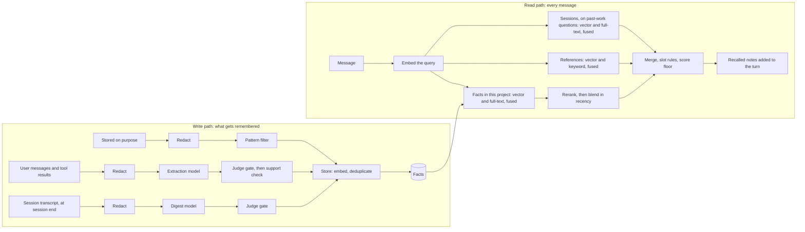
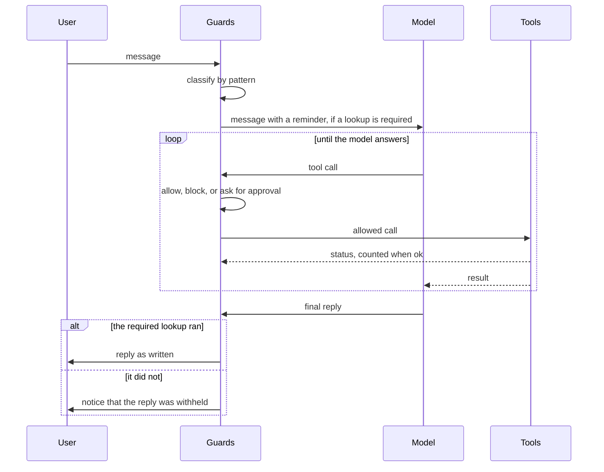

# Architecture

This document describes how the custom build is put together: the memory provider, retrieval, the memory store, the guards and failure handling. It describes the design, not the rules for changing it; those are in [CONTRIBUTING.md](CONTRIBUTING.md). Where the build runs and how it is operated is in [OPERATIONS.md](OPERATIONS.md).

Facts about Hermes itself are stated for **Hermes v0.23.1**, read from its documentation and source. Re-check them before upgrading Hermes.

**Contents**

1. [Overview](#1-overview)
2. [The memory-provider contract](#2-the-memory-provider-contract)
3. [Retrieval](#3-retrieval)
4. [The memory store](#4-the-memory-store)
5. [Guards](#5-guards)
6. [Failure handling](#6-failure-handling)
7. [Logging](#7-logging)

## 1. Overview

The build extends Hermes through its documented extension points and leaves the Hermes core unmodified, so upstream updates can still be taken.[1]

| Part | Hermes extension point | What it does here |
|---|---|---|
| Memory provider | A memory provider plugin. Hermes allows one external provider at a time, calls it before each turn, and exposes its tools to the agent.[2][3] | Stores and searches long-term memory (sections 2–4) |
| Guards | Plugin hooks that run before the model is called, before each tool call and on the final reply.[4] | Force lookups and stop unsafe actions (section 5) |
| Skills | Hermes skills. Hermes lists every skill's name and description in the prompt itself, so recall does not search them. | Procedures the agent follows for recurring tasks |
| Instruction files | `AGENTS.md`, loaded from the directory a session runs in, and `SOUL.md`, loaded only from the Hermes home directory.[5] | The agent's operating rules and identity. This repository contains neither file (CONTRIBUTING.md section 9). |

Hermes's built-in memory stays on. It is two size-limited files, `MEMORY.md` (2,200 characters) and `USER.md` (1,375 characters), loaded into the prompt at the start of each session.[6] They hold standing rules and preferences. Identity is `SOUL.md`, not memory. Everything else lives in the memory provider.

Memory is shared. Several machines run the agent against one memory store, so every stored row records the project it belongs to and the machine that wrote it.

**One plugin.** The memory provider, the four guards, the skills and the failure module (section 6.1) ship as a single Hermes plugin named `custom_build`: one directory of that name at the root of this repository, with each code part a subpackage that reaches the failure module by a relative import. The pull request that adds the directory's first file adds its line to the `.gitignore` allow-list (CONTRIBUTING.md section 4.4). Hermes loads that directory twice:

- as an ordinary plugin, listed in `plugins.enabled`, which registers the guards' hooks, the skills and the redaction patterns when Hermes starts;
- as the memory provider, selected by `memory.provider`.

The manifest declares `kind: standalone`. Without it, Hermes treats a directory that defines a memory provider as a provider only and skips the ordinary load.[16] Hermes matches the two loads of one plugin by name, so the directory under `plugins/` carries the manifest's name, as `hermes plugins install` makes it.[16] The layout was run, and is supported, only with Hermes's default plugin isolation, `in_process`, which every agent host keeps (OPERATIONS.md section 3). The other mode, `host`, runs user plugin code in a separate process.[16]

`register()` runs under both loads, and hooks are the only registration the two loads share.[16] So each load registers what it needs:

- the ordinary load registers the guards' hooks, the skills and the redaction patterns, so the guards do not wait for the memory provider to load, and no guard can be missing on its own;
- the provider load registers the memory provider, whose tools Hermes takes from the provider itself,[3] and the redaction patterns again, so the provider never writes without them even if the ordinary load failed. Hermes keeps one copy of each pattern.[14]

`register()` tells the two loads apart by the context Hermes passes it: the provider load passes a narrower context, with no `state` attribute (section 2).[14] The developer guide does not describe this (section 5.6). Hermes v0.23.1 lists a plugin's registered skills in the prompt with the others.[16]

Hermes imports the directory once for each load, under two module names, so anything held at module level exists twice.[16] The guards and the provider share nothing in memory, and each copy opens its own connection to the store. What they share goes through the memory store or the plugin's storage (section 2).

Hermes's developer guide says a memory provider can also load as an ordinary plugin, and that the ordinary load then owns its hooks.[15] It does not describe `kind: standalone` on such a directory, the two imports, or the two contexts `register()` receives. Those are read from the v0.23.1 source, were run against a throwaway plugin, and are re-tested on every Hermes upgrade (OPERATIONS.md section 5). The layouts that were compared, and the runs behind this one, are in #20.

## 2. The memory-provider contract

- **Prefetch blocks the turn.** Hermes waits for `prefetch()` for up to 8 seconds, then treats a timeout or an error as "no notes" and carries on. The provider therefore enforces its own deadline below 8 seconds. On failure it returns a "recall failed" note with its failure code instead of raising, because that is the only way the failure reaches the turn.
- **There is no input for a second query.** `prefetch()` receives only the user's message. The action query (section 3.5) therefore runs from a `pre_llm_call` plugin. Hermes runs `pre_llm_call` before prefetch, bounds it with its own callback timeout (`plugins.hook_callback_timeout`, 30 seconds by default), and skips prefetch entirely for a turn that `pre_llm_call` blocks.[4]
- **The project key comes from the session's working directory.** Both copies of the code (section 1) read it with Hermes's documented helper, `agent.runtime_cwd.resolve_agent_cwd()`, and turn it into a key the same way.[3][15] `initialize()` receives the directory as `cwd` only when the agent was built with one, and only as it was at that moment, so neither copy relies on it.[3][14] The key comes from the repository, so it is the same on every machine: the normalised URL of the repository's `origin` remote, or a project ID set in the repository's Hermes configuration when there is no remote. An absolute path is never used, because it differs between machines. A workspace that is not a repository has no project. Neither copy calls `os.getcwd()` itself.
- **Every entry point goes through one boundary wrapper.** Hermes contains errors from hooks and providers, often silently (section 5.5). Each function Hermes calls is wrapped by a single shared wrapper in the failure module. On an unexpected exception it records the failure with its traceback (section 6), then does what that entry point requires:

  | Entry point | Recorded as | Then |
  |---|---|---|
  | A guard on `pre_tool_call` or `transform_llm_output` | `guard.crash` | Re-raises, so Hermes blocks the call or withholds the reply |
  | A guard on `pre_llm_call` | `guard.crash` | Returns a block that names the failure |
  | The action query on `pre_llm_call` | `unhandled` | Returns a "recall failed" note, so the turn and the message query go ahead |
  | `prefetch()` | `unhandled` | Returns a "recall failed" note |
  | Any other provider method | `unhandled` | Re-raises |

  This wrapper, and the job wrapper (section 6.1), are the only code allowed to catch everything (CONTRIBUTING.md rule C2).
- **A provider tool that raises reaches the agent as a tool error.** Hermes catches an exception from a provider's tool and returns an error result that names the tool and carries the exception's message, so the agent never sees it as an empty result.[14] The memory search tool is a provider tool and goes through the boundary wrapper like any other provider method: an unexpected exception is recorded as `unhandled` and re-raised. A failure the tool expects, such as a missed deadline or an unreachable store, is returned as a failure result that carries its code in an `error` field (CONTRIBUTING.md rule C3). Hermes then reports the call with the status `error`, so no guard counts it as a lookup (section 5.3).[14]
- **Threads.** Background work uses Hermes's `spawn_context_thread`, never a bare `threading.Thread`, which would write into the wrong profile's store. `register(ctx)` builds a new provider instance on each provider load.
- **Local state.** What a guard keeps on a machine between calls, such as its record of what a session has read, goes through Hermes's per-plugin storage: `ctx.state`, which is scoped to the profile and limited to 10 MiB for each plugin, or the plugin's data directory. Nothing is written into the plugin's own directory, which a reinstall replaces, or into `config.yaml`.[15] The guards get that storage from the ordinary load (section 1). The memory provider is loaded through a narrower context that forwards only registration calls, so it has no `ctx.state`.[14] It uses Hermes's `plugins.plugin_storage` helpers, which give a plugin a data directory and a SQLite database under the Hermes home.[16]
- **Built-in memory writes are mirrored.** `on_memory_write` reports every committed write to `MEMORY.md` or `USER.md`. The provider stores them as deliberate facts.
- **Session end.** The provider's own `on_session_end` method fires at real session boundaries only, never per turn, and the digest is written there. The plugin hook with the same name is a different call: it fires at the end of every turn's run, so no session-end work is attached to it.[14][15]
- **Subagents get no automatic recall or writes.** Hermes suppresses prefetch, sync and session-end calls for subagents.[3]

## 3. Retrieval

The model keeps nothing between turns except the built-in memory files. Every message triggers a search, and the best results are added to the turn before the model reads it. A separate write path decides what is stored.



### 3.1 The stores

| Store | What it holds | How it is searched |
|---|---|---|
| Built-in memory | Standing rules and preferences | Not searched. It is in every prompt.[6] |
| Facts | Short facts and decisions, and one digest per long session | By meaning and by exact words, then reranked |
| Sessions | What was said in past conversations in the last 90 days, cut into chunks | By meaning and by exact words, on questions about past work |
| References | Long write-ups and procedures | By meaning and by exact words |

Facts go in the facts store. Long procedures and write-ups are references. What was said is in sessions. How to do a task is a skill.

The sessions store is kept only while the eval set (section 3.8) shows it adds recall over Hermes's built-in `session_search`, which already searches every past session by full text.

### 3.2 Embedding

- **One model for every store.** Facts, chunks and queries are all embedded by `Qwen3-Embedding-4B` at its native 2,560 dimensions, so their vectors are comparable.
- **One build on every machine.** The model build is pinned by its digest and recorded with every vector (`embedding_model`). A machine whose build differs refuses to run recall (`embed.model_mismatch`). A vector from a different build is never stored.
- **Storage.** Vectors are stored as `halfvec(2560)` with an HNSW cosine index. At this size the half-precision type is required: an HNSW index supports `vector` only up to 2,000 dimensions and `halfvec` up to 4,000. Indexing `halfvec` needs pgvector 0.7.0 or later.[7]
- **Query instruction.** Queries are prefixed with the task instruction the model card recommends; documents are embedded without one.[8] It becomes the default only after the eval set shows the gain.
- **What is embedded.** A fact is embedded once, when it is stored. Reference and session text is cut into chunks of about 800 characters. Each chunk is prefixed with its origin: the file and heading for a reference, the user's message for a session reply.
- **Caching.** A query is embedded once per turn and reused by every store.
- **No substitute model.** If the embedding service is unavailable, search fails with `embed.unavailable` and new facts are refused.

### 3.3 The write path

1. **Three entrances.**
   - The agent stores a fact on purpose.
   - An extraction model reads the user's messages and tool results (command output, file contents, documentation lookups) and proposes facts. It never reads the agent's own replies, because a wrong reply would otherwise be recalled later as a known fact.
   - At the provider's `on_session_end` (section 2), a digest model writes one digest for each long session (section 3.6) that does not have one yet.
2. **Redaction before any model sees the text.** The message, the tool output and the session transcript are redacted before they reach the extraction, digest or judge model, and before anything is stored (CONTRIBUTING.md rule L4). If redaction fails, nothing is sent or stored (`redact.failed`).
3. **A filter on each.**
   - A fact stored on purpose passes a pattern filter: it must meet the minimum length and must not match the narration patterns in the write-path configuration file.
   - Extracted facts and digests go to a judge model, which drops the ones not worth keeping.
   - An extracted fact then gets a separate check: does its source turn support it? A fact its source does not support is not stored.
   - If the judge errors, the fact is queued for retry, never stored unchecked (`store.gate_error`).
4. **One store function.** All three entrances then go through one function. It embeds the text and compares it with what is already stored in the same project. "Short" and "long" are defined in section 3.6.

   | Match with an existing fact | Result |
   |---|---|
   | Identical text | Not inserted |
   | Very close in meaning, short text | The new fact supersedes the old one |
   | Very close in meaning, long text, or somewhat close in meaning | The judge decides whether it is the same subject and whether the new fact supersedes the old |

5. **Origin protects deliberate facts.** A fact stored on purpose can supersede an extracted one. The reverse is never allowed.
6. **Every fact records its basis and source.** `basis` is `user_stated`, `tool_observed` or `assistant_inferred`; `source_turn` points to the turn it came from. A digest takes the weakest basis of its inputs, so a summary never turns an inferred claim into a stated one. Recalled notes show the basis.
7. **Nothing is silently lost.** A superseded or retired fact stays in the table, marked, with a pointer to its replacement or the reason it was retired.

### 3.4 Retrieval

Retrieval is hybrid, with a rerank stage. A search by meaning and a search by words each produce a ranked list, fused by rank position (reciprocal-rank fusion). A row found both ways usually ranks above a row found one way, but not always: a row ranked low in both lists can score below a row ranked first in one.

| Store | By meaning | By words | Fusion | Rerank |
|---|---|---|---|---|
| Facts | Cosine distance over vectors | Postgres full-text, any of the query's words | Rank fusion, inside one SQL function | Yes |
| References | Cosine over chunks | BM25 over the same chunks, in application code | Rank fusion | No |
| Sessions | Cosine over chunks | Postgres full-text | Rank fusion | No |

For the facts store:

1. Embed the query.
2. Fetch a candidate pool larger than the number of results wanted, from live rows in the current project. A session with no project searches live rows in every project.
3. Fuse the two ranked lists.
4. Rerank the pool with the judge model, under the judge deadline (section 3.6). If the judge errors or misses that deadline, the pool keeps its fused order and the result is recorded as degraded (`rerank.fallback`), never as a silent success. No local reranker is kept as a fallback. A cross-encoder would fit the recall deadline for a pool of short facts on an agent host with no GPU (about 2 seconds for 30 facts, #15), but it would put a second model and its runtime on every agent host only for the turns when the judge is down. Whether a cross-encoder should replace the judge as the reranker is a question for the eval set.
5. Blend recency back in, on a reranked pool only. A rerank score ignores age, so the final score adds a recency term from `last_verified_at`, or `created_at` for a fact never checked.[9] Its weight is set by the eval set. A pool whose rerank failed keeps its fused order (step 4).
6. Return the top results. Each result records which searches found it and which stage ranked it.

**Filtering and the vector index.** pgvector applies `WHERE` conditions after the HNSW scan, so a filtered search can return fewer rows than asked for.[10] The search functions set `hnsw.iterative_scan = relaxed_order` (pgvector 0.8.0 and later). The facts index is partial, over live rows only, and queries repeat that predicate exactly so the planner uses it.

**Word queries.** The full-text side joins the query's words with OR and ranks with `ts_rank_cd`. `plainto_tsquery` and `websearch_to_tsquery` both join unquoted words with AND, so with either one a long question matches nothing.[11] Postgres full-text ranking is not BM25: it uses no statistics from the rest of the collection.[11] BM25 for references therefore runs in application code.

### 3.5 Delivery

1. **Every message is searched.** Only an empty message is skipped.
2. **Two searches run, one after the other** (section 2), once the action query is switched on; until then only the message query runs:
   - **The action query, first.** In `pre_llm_call`, one request, the routing request, goes to the judge model with the user's message and the end of the assistant's previous reply, which Hermes passes to the hook in the conversation history.[14] The judge answers two typed questions, each with a probability: which kind of work from a fixed action list the message asks for, and whether it asks for work at all. The facts store is searched with the picked action's description, and the results are added to the turn through the hook's own context.
     - The action query ships switched off, and is switched on only once the eval set has measured it (#26).
     - The judge always returns a pick, whatever the message. The action query therefore runs unless "asks for work at all" is a clear no (section 3.6). The top pick is used whatever its probability; whether a low one should count as no pick is a question for the eval set (#26).
     - A skipped action query is recorded in `events` under its own event name, so it cannot be mistaken for one that ran and found nothing, which is recorded as `empty`.
     - The action list and the wording of the two questions are one configuration file in this repository. Changing either is a pull request with eval-set numbers (CONTRIBUTING.md rule C8).
     - The routing request runs under the judge deadline, and the action query as a whole under its own deadline, well inside Hermes's callback timeout (section 3.6). If the routing request errors or misses its deadline, the action query is skipped for that turn, the failure is recorded (`judge.error` or `judge.timeout`), and the turn carries a note with the code. If the search that follows misses the action query's deadline, that is `recall.timeout`.
     - A model that writes the action as free text is not used. In a benchmark on an agent host with no GPU, a local one took 4.5 to 8 seconds for each message. The judge answered in about 0.2 seconds, and its pick was among the answers the test's labels accepted on 42 of 44 messages (#15). Whether a search by the picked action finds the same facts as a search by a freely written one has not been measured; the eval set settles it before the action query is relied on (#26).
   - **The message query, second.** `prefetch()` searches the user's words across the stores, under its own deadline below Hermes's 8-second limit.
3. **Questions about past work widen the search.** They fetch more results and add past sessions. A question about past work is one that the recall gate's patterns match (section 5.3), so the search and the gate always agree on it.
4. **"What is left to do?" is not a similarity search.** A question about open work returns the newest digests' open items for the current project, newest first. Such a question has no topic words to match, and its answer depends on recency. It is recognised by patterns kept in the same configuration file as the recall gate's.
5. **Slot rules keep the mix fair.** The merge drops reranked facts under the score floor, then applies a cap on digests, reserved places for references and the cut to the number of results per message (section 3.6). The floor applies only where the score is a probability: the judge's rerank score for a fact. Results ranked by fusion alone, which are session chunks, references, and facts whose rerank failed, have no floor and are cut by rank only.
6. **Results are attached to the message** as recalled notes, labelled as notes and not as instructions. Each note shows its origin, its basis, the date it was stored and, when checked since, the date it was last verified.
7. **The agent can also search on demand** with the memory search tool.

A recall that fails or misses its deadline is reported in the turn with its failure code. It is never presented as "no notes found".

### 3.6 Defaults

These are configuration values. Change one through an issue, with eval-set numbers from before and after (CONTRIBUTING.md rule C8).

| Setting | Default |
|---|---|
| Chunk size | 800 characters; 100 shared between neighbouring session chunks |
| Rank-fusion constant | 20 for facts and references, 60 for sessions |
| Candidate pool for facts | Three times the results wanted, at least 15 |
| Short text, long text | Short is 300 characters or fewer; long is anything longer |
| Long session (gets a digest) | 20 messages or more |
| Minimum fact length | 10 characters |
| Supersede without the judge | Cosine similarity 0.92 or higher, short texts only |
| Ask the judge | Cosine similarity from 0.80 up to 0.92, or 0.92 and higher for long texts. The judge returns two probabilities, "same subject" and "the new fact supersedes the old"; both must be 0.75 or higher. |
| Judge gate | Drops at a drop score of 0.70 or higher |
| Results per message | 5; 8 on a question about past work; 3 for the action query |
| Score floor | 0.30, on facts the judge reranked, where the score is the judge's probability that the fact helps answer the message: under 0.3 reads as no, as in the "Asks for work at all" row. No floor on results ranked by fusion alone. A starting value; the eval set confirms or changes it. |
| Recall deadline (`prefetch()`) | 6 seconds |
| Action query (section 3.5) | Off, until the eval set has measured it (#26) |
| Action-query deadline (`pre_llm_call`) | 6 seconds |
| Judge deadline (one rerank or routing request) | 2 seconds. A starting value: the slowest routing request in the test for #15 took 0.3 seconds, and a rerank request has not been timed. |
| Previous reply sent with the routing request | Its last 500 characters, as in the test for #15 |
| "Asks for work at all" (section 3.5) | A probability under 0.3 is a clear no, and the action query is skipped. Anything higher runs it. A starting value, the one used in the test for #15; the eval set confirms or changes it (#26). |
| Recency weight | Set by the eval set |
| Recalled-note budget | Set by the eval set |

Hermes caps the context that one `pre_llm_call` hook adds to a turn at 10,000 characters by default. Anything above the cap is written to a file and replaced in the turn with a preview and the file's path.[15] The action query's notes are added to the turn by that hook (section 3.5), so their budget stays below the cap.

Still open, each tracked in its own issue:

- Whether reference chunks move into the shared store, decided with eval-set numbers once the facts store exists (#3).
- What identifies a session chunk's message, so that it never repeats after Hermes compacts or rewinds a session (#17).
- Whether Hermes's safe-worker mode leaves the guards' hooks unfired, checked with the first code (#23).
- Whether a search by the picked action finds what a search by a freely written one would, and whether a low-probability pick should count (#26).
- How the service finds the Python that Hermes runs on, the install and update procedure with real packages, an absence check for an agent host, and a signal when the guards fail to load while Hermes runs (#29).

### 3.7 What leaves the host

Every deployment states this in its own documentation:

- Stored facts, digests, session chunks and events go to the memory database, which keeps session chunks and events for 90 days (section 4.3).
- Search candidates, candidate facts and support checks go to the judge model when it is hosted.
- Each user message, with the end of the assistant's previous reply, goes to the judge model for routing (section 3.5) when it is hosted and the action query is switched on.
- User messages and tool output go to the extraction model when it is hosted.
- Session transcripts go to the digest model when it is hosted.
- The daily failure report goes to the operators' channel.

Secrets are redacted before anything is stored or sent.

### 3.8 The eval set

No ranking change ships without numbers from the eval set.

- It starts from LongMemEval-S, which covers information extraction, multi-session reasoning, temporal reasoning, knowledge updates and abstention.[12]
- It grows from real misses found in the `events` table: open-work questions answered badly, notes from the wrong project, recall that found nothing, and questions whose correct answer is "no note". A miss is promoted by copying it into the eval set; the `events` row itself is not kept.
- The eval set lives in this repository as data files, reviewed through pull requests like code. Each question records its project and the expected fact or chunk IDs. A question copied from a real miss expects facts, not session chunks: chunks are deleted after 90 days (section 4.3), and their text is conversation, which does not belong in this repository.
- Reports give recall@5, MRR and an abstention score.

## 4. The memory store

The memory store is a Supabase project: Postgres with the `pgvector` extension. It holds the facts, the session chunks and the events, and runs the hybrid search inside SQL functions.

### 4.1 Design rules

1. **One meaning for each column.** What a row is, where it came from, which project and session it belongs to and which machine wrote it are columns, never tags or fields in a shared blob.
2. **The lifecycle is in the database.** Each fact records when it was last verified and what superseded it. Search reads only live rows, so a stale fact cannot look like a current one.
3. **Nothing is hard-deleted by the agent.** A fact is superseded, with a pointer to its replacement, or retired, with a reason. The row stays.
4. **Every vector records the build that made it.** A change of embedding model is a visible migration, not a silent mismatch.
5. **Nothing unused.** No column, index or function argument exists without code that reads it.
6. **Any machine can write a session chunk.** A chunk is identified by its source, session, message position and chunk number, never by an identifier from one machine's local store. Rows carry Hermes's `session_id`. Compressing a transcript keeps it while `compression.in_place` is `true`, the default, which every agent host keeps; with `false`, Hermes would give the conversation a new `session_id`, and one conversation's rows would sit under two.[14][15] Hermes also changes the `session_id` on purpose, when a session is resumed, branched, reset or started anew. It tells the provider through `on_session_switch`, or through `initialize()` when a resumed session starts in a new process; rows already written keep the id they had.[3][14] A chunk's message position must never repeat within a session. A position in Hermes's message list can repeat after an in-place compaction or a rewind, so what identifies a chunk's message, and what happens to the chunks and facts of messages a rewind removed, is open (#17).

### 4.2 Schema

This is the plan. Once the first migration merges, the migration files are the source of truth and this section is updated to match.

```sql
create extension if not exists vector;
create schema memory;   -- not exposed through the Supabase Data API

create table memory.facts (
  id               uuid primary key default gen_random_uuid(),
  body             text not null,
  body_hash        text not null,            -- hash of the normalised body, for the identical-text check
  kind             text not null check (kind in ('fact', 'digest')),
  origin           text not null check (origin in ('explicit', 'extracted', 'digest', 'imported')),
  basis            text not null check (basis in ('user_stated', 'tool_observed', 'assistant_inferred')),
  project          text,                     -- project key (section 2); null when the session had none
  source           text not null,            -- the machine that wrote the row
  session_id       text,
  source_turn      integer,                  -- message position of the turn the fact came from
  embedding        halfvec(2560) not null,
  embedding_model  text not null,            -- model name and build digest
  search_text      tsvector generated always as (to_tsvector('english', body)) stored,
  created_at       timestamptz not null default now(),
  last_verified_at timestamptz,
  superseded_by    uuid references memory.facts (id),
  retired_at       timestamptz,
  retired_reason   text,
  check ((retired_at is null) = (retired_reason is null)),
  check ((kind = 'digest') = (origin = 'digest'))
);

create unique index facts_live_body_hash on memory.facts (project, body_hash) nulls not distinct
  where superseded_by is null and retired_at is null;
create index facts_live_embedding_idx on memory.facts using hnsw (embedding halfvec_cosine_ops)
  where superseded_by is null and retired_at is null;
create index facts_search_text_idx on memory.facts using gin (search_text);
create index facts_session_idx on memory.facts (session_id);   -- the digest job checks for an existing digest

create table memory.transcript_chunks (
  id               uuid primary key default gen_random_uuid(),
  source           text not null,            -- the machine that wrote the session
  project          text,
  session_id       text not null,
  message_seq      integer not null,
  chunk_no         smallint not null,
  body             text not null,
  embedding        halfvec(2560) not null,
  embedding_model  text not null,
  search_text      tsvector generated always as (to_tsvector('english', body)) stored,
  created_at       timestamptz not null default now(),
  unique (source, session_id, message_seq, chunk_no)
);

create index transcript_chunks_embedding_idx on memory.transcript_chunks using hnsw (embedding halfvec_cosine_ops);
create index transcript_chunks_search_text_idx on memory.transcript_chunks using gin (search_text);
create index transcript_chunks_created_at_idx on memory.transcript_chunks (created_at);   -- the retention job deletes by age

create table memory.events (
  id          bigint generated always as identity primary key,
  at          timestamptz not null default now(),
  source      text not null,                 -- the machine
  project     text,
  session_id  text,
  turn        integer,
  code        text not null,                 -- a code from the failure catalog, or an event name
  result      text not null check (result in ('ok', 'empty', 'failed', 'degraded')),
  reason      text,
  detail      jsonb not null default '{}'    -- IDs, scores, counts and hashes only; never content
);

create index events_at_idx on memory.events (at);
create index events_code_idx on memory.events (code, at);
```

| Column | Meaning |
|---|---|
| `kind` | A single fact, or a digest of a session |
| `origin` | Who wrote it: stored on purpose, extracted, written by the digest job, or imported |
| `basis` | What it rests on: the user said it, a tool showed it, or the agent inferred it |
| `project`, `source` | The project it belongs to, and the machine that wrote it |
| `last_verified_at` | When the fact was last checked against the live system |
| `superseded_by` | The fact that replaced this one. Empty on a live row. |
| `retired_at`, `retired_reason` | Set together when a fact is withdrawn without a replacement |
| `embedding_model` | The model and build that produced the vector |
| `events.result` | `ok`, `empty` (searched, found nothing), `failed`, or `degraded` (a fallback or a retry succeeded) |

Two SQL functions do the searching: `match_facts` and `match_transcript_chunks`. Each runs the vector and full-text searches and fuses them. `match_facts` reads live rows only; session chunks have no lifecycle, so `match_transcript_chunks` reads every chunk.

### 4.3 Access and migrations

- **The tables live in a schema the Supabase Data API does not expose**, so the project's API keys cannot reach them.
- **Each machine connects with its own role.** That role can read, insert and update. It cannot delete rows or create, alter or drop anything.
- **Row Level Security is on for every table, as a backstop.** With RLS on and no policy, Postgres denies every row to a role that does not own the table, so each machine's role gets explicit select, insert and update policies and no delete policy.[13]
- **Schema changes are migration files in this repository**, reviewed through a pull request. Migrations only move forward; an applied migration is never edited.
- **Data this repository did not create is not ours to change** (CONTRIBUTING.md rule C7). An export exists before any migration touches data.
- **Retention.** `events` rows and session chunks are deleted after 90 days by a scheduled job running as the maintenance role (OPERATIONS.md section 1). Facts and digests are kept. Older conversation is then recalled only through them, and a session too short for a digest (section 3.6) only through its facts. Misses worth keeping are copied into the eval set before then (section 3.8).

## 5. Guards

### 5.1 The principle

A rule in a prompt only asks. The model can skip a lookup that a prompt requests, and nothing visible happens when it does. A guard makes the skipped lookup fail where it can be seen. Every behaviour this project depends on is backed by a guard, or it is treated as a request the model may ignore.

### 5.2 The hook points

| Hook | When it runs | What a guard does there |
|---|---|---|
| `pre_llm_call` | Once per turn, before the model is first called | Classifies the message and adds a reminder to it. It can also end the turn. |
| `pre_tool_call` | Before each tool call | Checks the call. It can block it, by returning `{"action": "block", "message": ...}`, or send it to Hermes's approval gate, by returning `{"action": "approve", "message": ...}`.[15] |
| `post_tool_call` | After a tool call ends | Records what happened. Hermes also calls it for a call that was blocked or that raised, with a `status` that says so, and ignores its return value, so it can record but not enforce.[14][15] |
| `transform_tool_result` | After a tool returns | Replaces the result. To add a note, the guard returns the original result with the note appended. |
| `transform_llm_output` | On the final reply | Replaces the reply with a notice. Registered with `hold_stream=True`, so the reply is held until the guard has run. |



The reminder alone is not enough, because the model can ignore it as it ignores a prompt rule. Withholding the reply is the step that changes behaviour. It works only because the output guard registers with `hold_stream=True`; without it, a streamed reply reaches the user first and is replaced afterwards.[4]

### 5.3 The guards

| Guard | Acts when | What it forces |
|---|---|---|
| Fact gate | The user asks a checkable question | At least one lookup tool in that turn. A reply that gives a vendor procedure or a diagnosis also needs a documentation lookup. |
| Recall gate | The user asks about past work | Both the memory search and the session search. One alone does not count. |
| Verify gate | A tool call would change a managed file or setting | The session must have read it first, or the call is blocked. A reply that says what a file contains is withheld if the file was never read. |
| Write gate | A tool call matches the list of sensitive actions | A human approval. With nobody to answer, the call is blocked. |

What counts as a checkable question, a question about past work, a managed file or setting, and a sensitive action is defined in each guard's configuration file in this repository, as patterns and lists. Changing one is a pull request like any code change, with the guard's tests updated.

The guards rest on Hermes mechanisms that the table does not name:

- **The fact gate, the recall gate and the verify gate count a tool from `post_tool_call`**, and only when its `status` is `ok`. A lookup reported with any other status, such as `error` or `blocked`, does not count. The verify gate keeps its record of what a session has read in the plugin's local state (section 2).
- **The write gate asks through Hermes's own approval gate**, by returning the `approve` directive from `pre_tool_call`. The request goes to a person; Hermes's model-based approval is not on this path. Hermes blocks the call when the person denies it, when the gate errors or times out, and when nobody can answer: in a scheduled run under the default `approvals.cron_mode: deny`, and in any other non-interactive context apart from the bypasses in section 5.6.[14] Each request carries a `rule_key` for the one action pattern it matched, so a person's "always" answer covers that pattern and not the whole tool; without a key, Hermes keys the answer on the tool.[4][14] The write gate records each request it sends in `events`. A person's answer arrives after the guard has returned, so it is recorded from Hermes's `post_approval_response` hook, and every "always" answer is listed in the daily report (OPERATIONS.md section 4). When the gate decides without asking, no approval hook fires: a call approved from an earlier answer shows as the request followed by `post_tool_call` with the status `ok`, and a blocked call as `post_tool_call` with the status `blocked`. Before it asks, the write gate asks Hermes whether it would approve without asking, using both of Hermes's checks: one for yolo, including a one-shot run, and one for an approval bypass, including `approvals.mode` switched to `off` while Hermes runs. If either reports a bypass, the gate blocks the call itself instead of asking (section 5.6).[14]

Hermes's memory tool enforces the size limits of `MEMORY.md` and `USER.md` itself, so there is no memory-cap guard.[6]

### 5.4 How a guard is built

1. **Detect from the input, cheaply.** A pattern match on the message decides before the model answers. No model judgment is involved.
2. **Remind in the turn**, and keep the requirement in front of the model until it is met.
3. **Count the tool by name once it has run**, from `post_tool_call` with the status `ok`, including tools called inside a batch.
4. **Enforce at the output.** Block the call or withhold the reply.
5. **Record every decision.** Each arm, block, withhold and approval is logged and written to `events`.
6. **Ship in log mode first.** Each guard has three modes: `on`, `log` (detect and record only) and `off`. Read the records for false triggers, then enforce.

### 5.5 Failure behaviour

- **At startup.** Hermes does not stop for a plugin that fails to load: it is skipped with a startup warning, and the others keep loading.[1] A plugin cannot make Hermes refuse to start, because the loader catches an error raised while a plugin loads, and no plugin hook fires at startup.[16] The check therefore runs outside Hermes. The service that keeps the Hermes gateway running on an agent host runs the build's startup check first, and does not start Hermes when the check fails. The check loads the plugin in a process of its own, the way a host does: through Hermes's plugin discovery with the plugin enabled, and through its memory-provider loader. It is a script in the plugin's directory, so it is installed and updated with the plugin, and it runs through the job wrapper (section 6.1): a crash in it is recorded as for a scheduled job, and a failed check records the code of the condition that failed. It reads Hermes's settings through Hermes's own configuration loader, so it sees them as Hermes does. It passes only when:

  - the ordinary load reports no error, every guard's hooks are registered, and the provider loads (`guard.not_loaded`);
  - the build's own settings, such as the store's address and the machine's name, are present and valid (`config.missing`);
  - Hermes's own settings have the values the build depends on (`config.unsafe`): `memory.provider` is `custom_build`; plugin isolation is `in_process`; `approvals.mode` is not `off`; `approvals.cron_mode`, `approvals.single_query_mode` and `approvals.unattended_mode` are `deny`, because Hermes reads `approve`, `off`, `allow` and `yes` all as approve; `HERMES_YOLO_MODE` is not set; and `compression.in_place` is `true`.[14]

  It is a check before the start, not proof about the running process (section 5.6). How the service finds the Python that Hermes runs on is open (#29).
- **A missing setting inside Hermes.** The plugin's `pre_llm_call` hook checks the build's settings on every turn. When one is missing or invalid, it blocks the turn with a notice that names the setting (`config.missing`), so the agent never runs a turn with the build half configured. Hermes keeps a blocked turn's message only as a placeholder, so the message must be sent again once the setting is fixed.[4] A scheduled job that finds a setting missing stops with the same code. The manifest declares no settings for Hermes to check: Hermes would only log a warning for a bad `config_schema` value, or disable a plugin whose `requires_env` variable is unset, and start anyway.[15]
- **During a turn**, Hermes isolates hook errors, and the direction depends on the hook:[4]

  | Hook | When the callback raises or times out |
  |---|---|
  | `pre_tool_call` | The tool call is blocked (fails closed) |
  | `pre_llm_call` | The error is logged and the turn goes ahead (fails open) |
  | `transform_llm_output` | The error is logged and the original reply is delivered (fails open). With `hold_stream=True`, the reply is withheld instead. |
  | `transform_tool_result` | The error is logged and the callback is skipped (fails open) |

  Hermes logs the first such error at WARNING and identical repeats at DEBUG, so a guard that keeps failing goes quiet in Hermes's own log.

  The plugin developer guide says in general that a hook callback that crashes is logged and skipped.[15] That does not describe `pre_tool_call`: in v0.23.1 a callback that raises or times out there produces a block, and for a raise the block names the callback.[14]
- **Every enforcing guard fails closed, and every failure is recorded.** Each guard's entry point goes through the boundary wrapper (section 2), which records `guard.crash` with the traceback and then re-raises or blocks as the table in section 2 shows. Returning a block from `pre_llm_call` is what Nous recommends for policy hooks.[4] Recording happens in the wrapper on every occurrence, so it does not depend on Hermes logging a repeated error only once.
- **`transform_tool_result` is never used to enforce.** Hermes skips a callback that raises there, so a guard on it fails open. It is used only to annotate a tool result, and its failures are recorded by the wrapper like any other.

### 5.6 Known limits

- Detection is by pattern. A question phrased outside the patterns gets no reminder, no wider search and no open-items answer.
- A lookup check proves that a lookup happened, not that it was the right one.
- While a reply is held, tool progress and reasoning still show unless turned off, and commentary between tool calls is dropped.[4]
- Any exemption, such as for subagents or system notifications, is written down. An exempt path produces unguarded claims.
- A Hermes started by hand, outside the service, skips the startup check (section 5.5). Hermes logs a warning for a plugin that failed to load, but nothing in Hermes stops it or records `guard.not_loaded`.
- The startup check runs in a process of its own before Hermes starts. It does not prove the load in the process that serves requests, where a plugin's load has its own deadline, plugins can be reloaded while Hermes runs, and Hermes's safe mode skips plugin discovery.[16] If the ordinary load fails there while the provider loads, the provider runs with no guards, and nothing reports it during the turn (#29).
- Some of the build rests on Hermes behaviour that the developer guide does not describe: `kind: standalone` on a memory provider's directory and the two imports it causes (section 1), `register()` telling the two loads apart by its context, the startup check calling Hermes's plugin loader and configuration loader directly, and the write gate's checks for an approval bypass. Each is re-tested on every Hermes upgrade (OPERATIONS.md section 5).
- Hermes's approval gate approves without asking in four cases, and the write gate does not hold in them:[14]
  - yolo is on, by any route: the `--yolo` flag, the `HERMES_YOLO_MODE` variable, the `/yolo` command in a CLI or gateway session, or a one-shot run started with `hermes -z`;
  - `approvals.mode` is `off`;
  - the person earlier answered "for this session" or "always" for the same rule, which is the whole tool unless the guard names a narrower rule;
  - an unattended context has its mode set to `approve` (`approvals.cron_mode`, `approvals.single_query_mode`, `approvals.unattended_mode`; each defaults to `deny`).

  The build answers each. The startup check fails on `approvals.mode: off`, on any of the three unattended modes set to anything but `deny`, and on `HERMES_YOLO_MODE` (section 5.5). During a turn, the write gate blocks outright when Hermes reports yolo or an approval bypass for the session. That also covers yolo turned on by the `--yolo` flag on the command that starts the gateway, or restored from an earlier `/yolo`, neither of which the startup check can see. An earlier answer covers only one action pattern, and every "always" answer is reported (section 5.3). Not covered: one of the three unattended modes switched to `approve` while Hermes runs, which the startup check cannot see and the write gate does not check.[14]

## 6. Failure handling

Every point of failure has a name, and a failure, an empty result and a fallback can always be told apart. The rules are F1–F6 in CONTRIBUTING.md; this section describes the mechanism.

### 6.1 The failure catalog

The catalog is one module in the package. It lists every failure code, its severity and whether it is shown in the turn. A test fails the build if any handler or fallback emits a code that is not in it, or emits none.

Two wrappers in the same module record what no handler caught. The boundary wrapper covers every entry point Hermes calls (section 2). The job wrapper covers every scheduled job: on an unexpected exception it records `unhandled` and `job.failed` with the traceback, then exits non-zero, so Hermes cron also sends its own error alert (OPERATIONS.md section 4). The startup check (section 5.5) runs through the job wrapper too: a crash in it is recorded as `unhandled` and `job.failed`, and the check exits non-zero. These two wrappers are the only code allowed to catch everything.

Initial codes:

| Code | Raised when |
|---|---|
| `embed.unavailable` | The embedding service cannot be reached |
| `embed.model_mismatch` | This machine's embedding build differs from the one recorded in the store |
| `db.unreachable`, `db.auth`, `db.query` | The memory store cannot be reached, refuses the role, or rejects a query |
| `recall.timeout` | Recall misses its deadline |
| `judge.timeout`, `judge.error` | The judge model times out or errors |
| `rerank.fallback` | The judge could not rerank, and the pool kept its fused order (degraded) |
| `store.gate_error` | The judge failed during a write; the fact is queued |
| `guard.crash`, `guard.not_loaded` | A guard raised during a turn (recorded instead of `unhandled`), or the startup check found the plugin, a guard's hooks or the provider not loaded |
| `config.unsafe` | The startup check found a Hermes setting with a value the build does not support (section 5.5) |
| `config.missing` | A setting the build needs is missing or invalid: the startup check fails, a scheduled job stops, and inside Hermes every turn is blocked (section 5.5) |
| `redact.failed` | The redactor raised; the text is not stored or sent |
| `memory.write_rejected` | Hermes refused a built-in memory write |
| `events.write_failed` | An `events` row could not be written; logged locally at ERROR |
| `job.failed`, `job.missed`, `job.no_output` | A scheduled job or the startup check failed; a scheduled job did not run, or took input and produced nothing |
| `unhandled` | Anything not in the catalog, outside a guard. Recorded with its traceback by the boundary wrapper or the job wrapper. |

### 6.2 Where a failure appears

| Place | What appears |
|---|---|
| `errors.log` (Hermes) | Every occurrence, at WARNING or above |
| `events` table | Every occurrence, with its code, result and reason |
| The turn | A short notice, when the failure changed the answer |
| The daily failure report | Every failure of the day, grouped by code and machine |

A retry that succeeds is recorded as `degraded` with its retry count, so a flaky dependency shows up as a trend before it becomes an outage.

### 6.3 Absence checks

Some failures raise nothing. A daily check flags any scheduled job with no fresh success (`job.missed`), and any job that processed input but produced no output for more than one run (`job.no_output`). The daily report is itself checked by its absence: a day with no report is treated as a failure (OPERATIONS.md section 4). A failed startup check is recorded in `events`, so it reaches the daily report when the host can reach the store. A host that cannot reach the store, or does not run at all, has no absence check yet (#29).

## 7. Logging

Hermes owns logging for everything that runs inside it.[14]

- It writes `agent.log`, `errors.log` (WARNING and above) and, in gateway mode, `gateway.log` under `~/.hermes/logs/`.
- It rotates them: 5 MB and 3 backups by default, set by `logging.max_size_mb` and `logging.backup_count`.
- It passes every line through a redacting formatter.
- `hermes logs` filters by session, component and time.

What Hermes does not provide, and the build adds:

- **Supabase API key formats.** Hermes's redactor has no pattern for `sb_secret_` or `sb_publishable_` keys, so the build registers them through `register_redaction_patterns`.
- **Redaction outside logs.** Hermes redacts log lines only. The build redacts every value before it is written to the store or sent off the host.
- **Structure.** Hermes's lines are plain text. Each event the build logs is one line whose message is a single JSON object, written by one helper in the failure module that both logs the line and writes the `events` row, so the two always use the same fields.
- **Durability.** Logs rotate and live on one machine. Decisions and failures also go to `events`, which every machine shares.

The rules are L1–L5 in CONTRIBUTING.md.

## Sources

- [1] [Plugins (Hermes Agent documentation)](https://hermes-agent.nousresearch.com/docs/user-guide/features/plugins)
- [2] [Memory providers (Hermes Agent documentation)](https://hermes-agent.nousresearch.com/docs/user-guide/features/memory-providers)
- [3] [Memory provider plugins (Hermes Agent developer guide)](https://hermes-agent.nousresearch.com/docs/developer-guide/memory-provider-plugin)
- [4] [Hooks (Hermes Agent documentation)](https://hermes-agent.nousresearch.com/docs/user-guide/features/hooks)
- [5] [Context files (Hermes Agent documentation)](https://hermes-agent.nousresearch.com/docs/user-guide/features/context-files)
- [6] [Memory (Hermes Agent documentation)](https://hermes-agent.nousresearch.com/docs/user-guide/features/memory)
- [7] [HNSW indexes (Supabase Docs)](https://supabase.com/docs/guides/ai/vector-indexes/hnsw-indexes)
- [8] [Qwen3-Embedding-4B model card (Hugging Face)](https://huggingface.co/Qwen/Qwen3-Embedding-4B)
- [9] [Park et al., Generative Agents: Interactive Simulacra of Human Behavior, arXiv 2304.03442](https://arxiv.org/abs/2304.03442)
- [10] [pgvector README: filtering and iterative index scans](https://github.com/pgvector/pgvector)
- [11] [Controlling text search (PostgreSQL documentation)](https://www.postgresql.org/docs/current/textsearch-controls.html)
- [12] [Wu et al., LongMemEval, arXiv 2410.10813](https://arxiv.org/abs/2410.10813)
- [13] [Row security policies (PostgreSQL documentation)](https://www.postgresql.org/docs/current/ddl-rowsecurity.html)
- [14] Hermes v0.23.1 source: `hermes_logging.py`, `model_tools.py`, `agent/redact.py`, `agent/agent_init_memory_provider.py`, `agent/memory_provider.py`, `agent/memory_manager.py`, `agent/turn_context.py`, `gateway/session_finite.py`, `hermes_cli/cli_session_mixin.py`, `hermes_cli/config_defaults.py`, `hermes_cli/main.py`, `hermes_cli/plugins.py`, `hermes_cli/plugins_context.py`, `hermes_cli/plugins_dispatch.py`, `plugins/memory/__init__.py`, `tools/approval.py`, `tools/approval_context.py`, `tools/approval_yolo.py`
- [15] [Build a Hermes plugin (Hermes Agent developer guide)](https://hermes-agent.nousresearch.com/docs/developer-guide/plugins)
- [16] Hermes v0.23.1 source, plugin loading: `agent/prompt_builder.py`, `hermes_cli/plugin_isolation.py`, `hermes_cli/plugins.py`, `hermes_cli/plugins_cmd_install.py`, `hermes_cli/plugins_content.py`, `hermes_cli/plugins_discovery.py`, `hermes_cli/plugins_ledger.py`, `hermes_cli/plugins_loader.py`, `hermes_cli/plugins_manifest.py`, `plugins/memory/__init__.py`, `plugins/plugin_storage.py`
