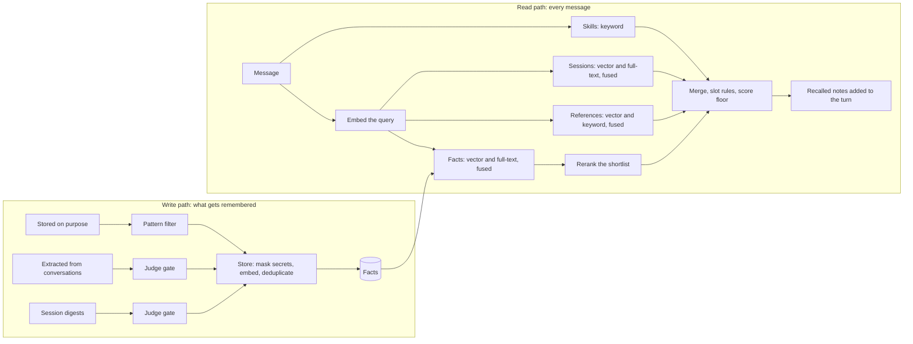
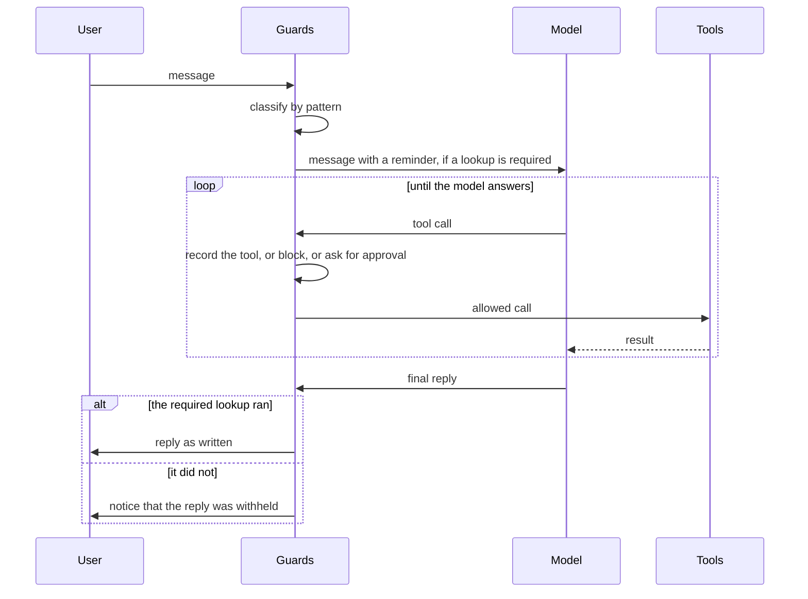
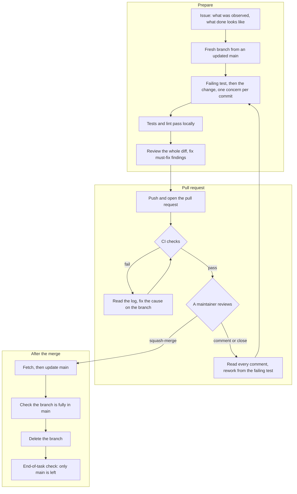

# Contributing

This document explains what this project is, how it is built, and how to contribute to it. Everyone who works in this repository follows it, whether a person or an AI coding agent. GitHub shows a link to this file to anyone who opens a pull request or creates an issue.[11]

**Contents**

1. [Hermes Agent, and where to ask about it](#1-hermes-agent-and-where-to-ask-about-it)
2. [What this project is for](#2-what-this-project-is-for)
3. [How the custom build is put together](#3-how-the-custom-build-is-put-together)
4. [Retrieval: how the agent remembers](#4-retrieval-how-the-agent-remembers)
5. [Memory in Supabase](#5-memory-in-supabase)
6. [How tools are fired and enforced](#6-how-tools-are-fired-and-enforced)
7. [Contribution workflow](#7-contribution-workflow)
8. [Coding standards](#8-coding-standards)
9. [Repository guards and CI](#9-repository-guards-and-ci)
10. [Contributing with an AI coding agent](#10-contributing-with-an-ai-coding-agent)

## 1. Hermes Agent, and where to ask about it

Hermes Agent is an open-source autonomous AI agent built by Nous Research. It runs on your own machine or a server, and you talk to it from a terminal, a desktop app or a messaging platform. It calls tools, keeps memory across sessions, and creates and improves its own skills from experience.[1] It is MIT-licensed and free to self-host.[2]

This project is a custom build on top of Hermes Agent. It does not replace the upstream documentation. For anything about Hermes itself, use the sources below. They are all published by Nous Research.

| Question | Where to look |
|---|---|
| What Hermes is, and how to install it | [Documentation home](https://hermes-agent.nousresearch.com/docs), [Installation](https://hermes-agent.nousresearch.com/docs/getting-started/installation), [Quickstart](https://hermes-agent.nousresearch.com/docs/getting-started/quickstart) |
| Which page to read for your level | [Learning path](https://hermes-agent.nousresearch.com/docs/getting-started/learning-path) |
| Common problems | [FAQ](https://hermes-agent.nousresearch.com/docs/reference/faq) |
| Configuration and security | [Configuration](https://hermes-agent.nousresearch.com/docs/user-guide/configuration), [Security](https://hermes-agent.nousresearch.com/docs/user-guide/security) |
| Tools and skills | [Tools](https://hermes-agent.nousresearch.com/docs/user-guide/features/tools), [Skills](https://hermes-agent.nousresearch.com/docs/user-guide/features/skills) |
| Built-in memory and external memory providers | [Memory](https://hermes-agent.nousresearch.com/docs/user-guide/features/memory), [Memory providers](https://hermes-agent.nousresearch.com/docs/user-guide/features/memory-providers) |
| Plugins and hooks | [Plugins](https://hermes-agent.nousresearch.com/docs/user-guide/features/plugins), [Hooks](https://hermes-agent.nousresearch.com/docs/user-guide/features/hooks) |
| Instruction files the agent loads (`AGENTS.md`, `SOUL.md`) | [Context files](https://hermes-agent.nousresearch.com/docs/user-guide/features/context-files) |
| How Hermes works inside | [Architecture](https://hermes-agent.nousresearch.com/docs/developer-guide/architecture), [Building a plugin](https://hermes-agent.nousresearch.com/docs/developer-guide/plugins), [Building a memory provider](https://hermes-agent.nousresearch.com/docs/developer-guide/memory-provider-plugin) |
| Updating Hermes | [Updating](https://hermes-agent.nousresearch.com/docs/getting-started/updating) |
| Source code, releases, and bugs in Hermes itself | [NousResearch/hermes-agent on GitHub](https://github.com/NousResearch/hermes-agent) |
| The documentation, for an AI agent | [llms.txt](https://hermes-agent.nousresearch.com/docs/llms.txt) (an index of every page), [llms-full.txt](https://hermes-agent.nousresearch.com/docs/llms-full.txt) (every page in one file) |
| Whether a site, download or account is really Hermes | [Official domains and sources](https://hermes-agent.nousresearch.com/docs/getting-started/official-domains) |

Three rules follow from this:

- **A question about stock Hermes behaviour goes to the Nous documentation**, not to an issue here.
- **A bug in Hermes itself is reported upstream**, in the Nous repository. Link it from an issue here if it blocks work.
- **Do not rely on third-party sites about Hermes.** Nous lists its official domains and accounts, and treats an installer, download, image or portal hosted anywhere else as untrusted.[2] Treat any other write-up about Hermes as unverified until the Nous documentation confirms it.

## 2. What this project is for

The goal is an agent whose answers can be trusted without re-checking them. That breaks down into three properties.

1. **It never forgets.** What was said, decided or learned is stored outside the model and searched on every message, so the agent answers from the record and not from what happens to be in its context.
2. **It does not state what it has not verified.** Every factual statement is backed by something the agent looked up in that turn: a document, a file, a command result, or a stored fact with its date. When it cannot verify something, it says so.
3. **It earns blind trust by being right, measurably.** Accuracy is enforced by code and measured by benchmarks. It is not requested in a prompt and assumed.

Each property maps to a part of the build:

| Property | What delivers it | Section |
|---|---|---|
| Never forgets | Memory in Supabase, with retrieval on every message | 4, 5 |
| Verified before stated | Guards that withhold a reply until the required lookup has run | 6 |
| Right, measurably | Tests, retrieval benchmarks, and code that fails loudly | 7, 8, 9 |

The same standard applies to contributions. A change that makes the agent sound more certain without making it more verifiable is rejected.

## 3. How the custom build is put together

This project extends Hermes through its documented extension points and leaves the Hermes core unmodified, so upstream updates can still be taken.

| Part | Hermes extension point | What it does here |
|---|---|---|
| Memory provider | A memory provider plugin. Hermes allows one external provider at a time, prefetches from it before each turn, and exposes its tools to the agent.[4][5] | Stores and searches memory in Supabase (sections 4 and 5) |
| Guards | Plugin hooks, which run custom code once per turn before the model is called, before each tool call, and on the final reply.[7] | Force lookups and stop unsafe actions (section 6) |
| Skills | Hermes skills | Procedures the agent follows for recurring tasks |
| Instruction files | `AGENTS.md`, loaded from the directory a session runs in, and `SOUL.md`, loaded only from the Hermes home directory (`~/.hermes`).[8] | The agent's operating rules (`AGENTS.md`) and identity (`SOUL.md`). This repository contains neither file (section 10). |

Hermes's built-in memory stays on. It is two small, size-limited files, `MEMORY.md` (2,200 characters) and `USER.md` (1,375 characters), loaded into the prompt at the start of each session.[3] They hold standing rules and preferences. Identity is `SOUL.md`, not memory. Everything else lives in the memory provider.

Plugins add tools, hooks and integrations without changing core code.[6] Keep it that way. If a feature cannot be built through an extension point, open an issue before touching anything upstream.

## 4. Retrieval: how the agent remembers

The model keeps nothing between turns except the built-in memory files. So every message triggers a search, and the best results are added to the turn before the model reads it. A separate write path decides what is stored in the first place.



### 4.1 The stores

| Store | What it holds | How it is searched |
|---|---|---|
| Built-in memory | Standing rules and preferences | Not searched. It is in every prompt.[3] |
| Facts | Short facts and decisions, and one digest per long session | By meaning and by exact words, then reranked |
| Sessions | What was said in past conversations, cut into chunks | By meaning and by exact words, on questions about past work |
| References | Long write-ups and procedures | By meaning and by exact words |
| Skills | The name and description of each skill | By keyword |

Facts go in the facts store. Long procedures and write-ups are references. What was said is in sessions. How to do a task is a skill.

### 4.2 Embedding

- **One model for every store.** Facts, chunks and queries are all embedded by the same model, so their vectors are comparable. The model is `Qwen3-Embedding-4B`, at its native 2,560 dimensions.
- **Storage.** Vectors are stored as `halfvec(2560)` with an HNSW cosine index. At the native size the half-precision type is required: an HNSW index supports the `vector` type only up to 2,000 dimensions, and `halfvec` up to 4,000.[9] The model can also output fewer dimensions, down to 32,[28] but this project keeps the native 2,560. Indexing `halfvec` needs pgvector 0.7.0 or later.[9] Check the installed version with `select extversion from pg_extension where extname = 'vector';`.
- **What is embedded.** A fact is embedded once, when it is stored. Reference and session text is cut into chunks of about 800 characters, and each chunk is prefixed with where it came from: the file and heading for a reference, the user's message for a session reply.
- **Caching.** A query is embedded once per turn and reused by every store.
- **No substitute model.** If the embedding service is unavailable, search fails with an error and new facts are refused. A vector from a different model is never stored, and an error is never returned as an empty result (rule C3).

### 4.3 The write path

1. **Three entrances.** The agent stores a fact on purpose. A periodic job extracts facts from recent conversations. Another job writes one digest for each long session that does not have one yet.
2. **A filter on each.** A fact stored on purpose passes a pattern filter. Extracted facts and digests go to a judge model, which drops the ones not worth keeping.
3. **One store function.** All three then go through the same function. It masks credential values, embeds the text, and compares it with what is already stored:

   | Match with an existing fact | Result |
   |---|---|
   | Identical text | Not inserted |
   | Very close in meaning, short text | The new fact supersedes the old one |
   | Very close in meaning, long text, or somewhat close in meaning | The judge decides whether it is the same subject and whether the new one supersedes the old |

4. **Origin protects deliberate facts.** A fact stored on purpose can supersede an extracted one. The reverse is never allowed.
5. **Nothing is silently lost.** A superseded or retired fact stays in the table, marked, with a pointer to what replaced it (section 5).

### 4.4 Retrieval

Retrieval is hybrid, with a rerank stage. A search by meaning and a search by exact words each produce a ranked list. The two lists are fused by rank position (reciprocal-rank fusion), so a row found both ways usually ranks above a row found one way. It is not guaranteed: a row ranked low in both lists can score below a row ranked first in one. A reranker then reads the question together with each shortlisted candidate and scores how well the candidate answers it.

| Store | By meaning | By exact words | Fusion | Rerank |
|---|---|---|---|---|
| Facts | Cosine distance over vectors | Postgres full-text | Rank fusion, inside one SQL function | Yes |
| References | Cosine over chunks | BM25 over the same chunks, computed in application code | Rank fusion | No |
| Sessions | Cosine over chunks | Full-text over transcripts | Rank fusion | No |
| Skills | None | Word overlap with name and description | None | No |

For the facts store, step by step:

1. Embed the query.
2. Fetch a candidate pool larger than the number of results wanted.
3. Fuse the two ranked lists.
4. Rerank the pool. The reranker is a judge model, with a cross-encoder (`bge-reranker-v2-m3`) as the second choice.
5. Return the top results. Each result records which searches found it and which stage ranked it.

The Postgres full-text searches build their query with `plainto_tsquery`, which joins the words with AND, so every word must match.[29] Long conversational questions therefore behave as meaning-only searches, and short exact terms such as names, flags and error codes get real hybrid behaviour.

Postgres full-text ranking is not BM25: it uses no statistics from the rest of the collection.[29] BM25 for references therefore runs in application code, and has to be replaced if reference chunks move into the database (section 5.2).

### 4.5 Delivery

1. **Every message is searched.** Only an empty message is skipped.
2. **Two searches run side by side**, under one deadline: one for the user's words, and one for a short description of the action the agent is about to take.
3. **Questions about past work widen the search.** They fetch more results and add past sessions.
4. **Slot rules keep the mix fair.** Scores from different stores are not on one scale, so the merge applies a score floor, a cap on digests, and reserved places for references.
5. **The results are attached to the message** as recalled notes, labelled as notes and not as instructions. Each note carries its origin, the date it was stored and, when it has been checked since, the date it was last verified.
6. **The agent can also search on demand** with the memory search tool.

A recall that fails or misses its deadline is reported in the turn as a failure. It is never presented as "no notes found" (rule C3).

### 4.6 Current defaults

These are configuration values. Change one through an issue, with benchmark numbers from before and after (rule C8).

| Setting | Default |
|---|---|
| Chunk size | 800 characters, 100 shared between neighbouring session chunks |
| Rank-fusion constant | 20 for facts and references, 60 for sessions |
| Candidate pool for facts | Three times the results wanted, and at least 15 |
| Supersede without the judge | Cosine similarity 0.92 or higher, short texts only |
| Ask the judge | Cosine similarity from 0.80 up to 0.92, or 0.92 and higher for long texts; both answers must score 0.75 |
| Judge gate | Drops at a drop score of 0.70 or higher |
| Results per message | 5; 8 on a question about past work; 3 for the action query |
| Score floor | 0.10 |
| Recall deadline | 6 seconds |

### 4.7 What leaves the host

State this plainly in any deployment's own documentation. Stored facts and session chunks go to the database. Search candidates and candidate facts go to the judge model when it is hosted. Session transcripts go to the model that writes digests. Credential values are masked before anything is stored.

## 5. Memory in Supabase

Supabase is the agent's long-term memory. It is a Postgres database with the `pgvector` extension. It holds the facts and the session chunks, and it runs the hybrid search for both inside SQL functions.

### 5.1 Design rules

1. **One meaning for each column.** What a row is, where it came from, and which session it belongs to are columns. They are never tags and never encoded in a shared field.
2. **The lifecycle is in the database.** Each fact records when it was last verified and what superseded it. Search reads only live rows, so a stale fact cannot look like a current one.
3. **Nothing is hard-deleted by the agent.** A fact is superseded, with a pointer to the fact that replaced it, or retired, with a reason. The row stays.
4. **Every vector records the model that made it.** A change of embedding model is then a visible migration, not a silent mismatch.
5. **Nothing unused.** No column, index or function argument exists without code that reads it.
6. **Any client can write a session chunk.** A chunk is identified by its source, session, message position and chunk number, never by an identifier from one machine's local store.

### 5.2 Planned schema

This is the plan. Once the first migration merges, the migration files in the repository are the source of truth and this section is updated to match.

```sql
create extension if not exists vector;

create table facts (
  id               uuid primary key default gen_random_uuid(),
  body             text not null,
  body_hash        text not null,            -- hash of the normalised body, for the identical-text check
  kind             text not null check (kind in ('fact', 'digest')),
  origin           text not null check (origin in ('explicit', 'extracted', 'digest', 'imported')),
  session_id       text,                     -- the session the fact came from, when there is one
  embedding        halfvec(2560) not null,
  embedding_model  text not null,
  search_text      tsvector generated always as (to_tsvector('english', body)) stored,
  created_at       timestamptz not null default now(),
  last_verified_at timestamptz,
  superseded_by    uuid references facts (id),
  retired_at       timestamptz,
  retired_reason   text,
  check ((retired_at is null) = (retired_reason is null)),
  check ((kind = 'digest') = (origin = 'digest'))   -- a digest is always written by the digest job
);

-- One live row per identical text. A retired or superseded row does not block a new one.
create unique index facts_live_body_hash on facts (body_hash)
  where superseded_by is null and retired_at is null;
create index facts_embedding_idx on facts using hnsw (embedding halfvec_cosine_ops);
create index facts_search_text_idx on facts using gin (search_text);
create index facts_session_idx on facts (session_id);   -- the digest job checks whether a session already has a digest

create table transcript_chunks (
  id               uuid primary key default gen_random_uuid(),
  source           text not null,            -- which client wrote the session
  session_id       text not null,
  message_seq      integer not null,         -- position of the message in its session
  chunk_no         smallint not null,
  body             text not null,
  embedding        halfvec(2560) not null,
  embedding_model  text not null,
  search_text      tsvector generated always as (to_tsvector('english', body)) stored,
  created_at       timestamptz not null default now(),
  unique (source, session_id, message_seq, chunk_no)
);

create index transcript_chunks_embedding_idx on transcript_chunks using hnsw (embedding halfvec_cosine_ops);
create index transcript_chunks_search_text_idx on transcript_chunks using gin (search_text);
```

| Column | Meaning |
|---|---|
| `kind` | What the row is: a single fact, or a digest of a session |
| `origin` | Who wrote it: stored on purpose, extracted from a conversation, written by the digest job, or imported |
| `last_verified_at` | When the fact was last checked against the live system |
| `superseded_by` | The fact that replaced this one. Empty on a live row. |
| `retired_at`, `retired_reason` | Set together when a fact is withdrawn without a replacement |
| `embedding_model` | The model that produced the vector |

Two SQL functions do the searching: `match_facts` and `match_transcript_chunks`. Each runs the vector search and the full-text search and fuses them. `match_facts` reads live rows only; session chunks have no lifecycle, so `match_transcript_chunks` reads every chunk. Neither takes an argument that no caller passes.

Still to be decided, each through its own issue: how long session chunks are kept (a retention job adds its own index on `created_at`), whether reference chunks move into the database, and how the score floor in section 4.6 applies when the stores' scores are not on one scale.

### 5.3 Access and migrations

- **Row Level Security is on for every table.** A table in an exposed schema without it is readable and writable by any role with a grant.[10]
- **The agent connects with its own role.** That role can read, insert and update. It cannot delete rows, and it cannot create, alter or drop anything.
- **Every table has explicit policies for the agent role.** With Row Level Security on and no policy, Postgres denies every row to a role that does not own the table.[30] The agent role gets select, insert and update policies, and no delete policy.
- **Schema changes are migration files in this repository**, reviewed through a pull request like any other change. Migrations only move forward. An applied migration is never edited.
- **Existing data is not ours to change** (rule C7). Where a database already holds data, new tables are created beside the old ones, rows are copied across, and counts and benchmark results are compared before anything switches over. Old tables are dropped later, by a maintainer.
- **An export exists before any migration touches data.**

## 6. How tools are fired and enforced

### 6.1 The principle

Tools fire reliably when code checks for them. A rule in a prompt only asks. The model can skip a lookup that a prompt requests, and nothing visible happens when it does. A guard makes the skipped lookup fail where it can be seen.

Every behaviour this project depends on is therefore backed by a guard, or it is treated as a request the model may ignore.

### 6.2 The hook points

Hermes lets a plugin register callbacks around each turn.[7] The guards use these:

| Hook | When it runs | What a guard does there |
|---|---|---|
| `pre_llm_call` | Once per turn, before the model is first called | Classifies the message and adds a reminder to the user's message. It can also end the turn. |
| `pre_tool_call` | Before a tool runs | Records which tool ran. It can block the call or send it for approval. |
| `transform_tool_result` | After a tool returns | Replaces the result. To add a note, the guard returns the original result with the note appended. |
| `transform_llm_output` | On the final reply | Replaces the reply with a notice. Registered with `hold_stream=True`, so the reply is held until the guard has run. |



The reminder alone is not enough, because the model can ignore it the same way it ignores a prompt rule. Withholding the reply is the step that changes behaviour: a reply that skipped the lookup never reaches the user.

That holds only because the output guard registers with `hold_stream=True`. Without it, a streamed reply reaches the user first and is replaced afterwards, so the user has already read it.[7]

### 6.3 The guards

| Guard | Acts when | What it forces |
|---|---|---|
| Fact gate | The user asks a checkable question | At least one lookup tool in that turn. A reply that gives a vendor procedure or a diagnosis also needs a documentation lookup. |
| Recall gate | The user asks about past work | Both the memory search and the session search. One alone does not count. |
| Verify gate | A tool call would change a managed file or setting | The session must have read it first, or the call is blocked. A reply that says what a file contains is withheld if the file was never read. |
| Write gate | A tool call matches the list of sensitive actions | A human approval. With nobody to answer, the call is blocked. |
| Memory cap | A built-in memory file is close to its size limit | Other tools are blocked until the file is trimmed |

### 6.4 How a guard is built

1. **Detect from the input, cheaply.** A pattern match on the message decides before the model answers. No model judgment is involved.
2. **Remind in the turn**, and keep the requirement in front of the model until it is met.
3. **Count the tool by name**, including tools called inside a batch.
4. **Enforce at the output.** Block the call or withhold the reply.
5. **Write a log line for every time it arms, blocks or withholds.** A guard with no log line did not fire.
6. **Ship in log mode first.** Each guard has three modes: `on`, `log` (detect and record only) and `off`. Read the log for false triggers, then enforce.

### 6.5 Failure behaviour

- **At startup, Hermes does not stop for a missing guard.** A plugin that fails to load is skipped with a startup warning, and the others keep loading.[6] This project therefore checks, before the agent takes requests, that every required guard is registered, and refuses to start if one is missing. Until that check exists, a missing guard shows only as the startup warning.
- **During a turn, Hermes isolates hook errors, and the direction depends on the hook.**[7]

  | Hook | When the callback raises or times out |
  |---|---|
  | `pre_tool_call` | The tool call is blocked (fails closed) |
  | `pre_llm_call` | The error is logged and the turn goes ahead (fails open) |
  | `transform_llm_output` | The error is logged and the original reply is delivered (fails open). With `hold_stream=True`, the reply is withheld instead. |
  | `transform_tool_result` | The error is logged and the callback is skipped (fails open) |

  Hermes logs the first such error at WARNING and identical repeats at DEBUG, so a guard that keeps failing goes quiet in the log.
- **Guards on `pre_tool_call` and `transform_llm_output` contain no catch-everything blocks** (rule C2). Hermes turns their bugs into a blocked call or a withheld reply.
- **A guard on `pre_llm_call` catches its own errors and returns a block**, as Nous recommends for policy hooks.[7] This is the one exception to rule C2. The handler logs the traceback, returns a block that names the failure, and never lets the turn continue.
- **Each guard states its failure direction** in its first comment: fail open (let things through when broken) or fail closed (block when broken), and why. A guard that protects data fails closed.

### 6.6 Known limits

State these in each guard's documentation.

- Detection is by pattern. A question phrased outside the patterns gets no reminder.
- A lookup check proves that a lookup happened. It does not prove it was the right one.
- While a reply is held, tool progress and reasoning still show unless they are turned off, and commentary between tool calls is dropped.[7]
- Any exemption, such as for sub-agents or system notifications, is written down. An exempt path produces unguarded claims.

## 7. Contribution workflow

This repository uses GitHub, squash-merge as the only merge method, and `main` as the default branch. Maintainers merge.

Placeholders used below: `<owner>/<repo>`, `<branch>`, `<n>` (an issue or pull request number), `<type>` (a commit type such as `feat` or `fix`), `<package>` (the Python package directory).

### 7.1 Rules

- **W1. Issue first.** Every pull request answers one issue. If none exists, create it before writing code: what was observed or asked for, and what done looks like. The issue is the whole scope. No change is too small for one.
- **W2. One branch per issue.** Name it `<type>/<short-description>`, cut it fresh from an up-to-date `main`, never reuse it for a second issue, and delete it once its pull request merges. `main` is the only long-lived branch.
- **W3. Test first, where a test can express it.** Write the test, watch it fail for the right reason, then write the minimum that passes. Write an error handler only when a test names the failure it handles. When a test cannot express the change, say so and report what was measured instead.
- **W4. One concern per commit**, with a conventional prefix: `feat:`, `fix:`, `refactor:`, `test:`, `chore:`, `docs:`, `ci:`.[19] A commit that needs "and" in its subject is two commits.
- **W5. Small pull requests.** One purpose each, with the tests for the change in the same pull request.
- **W6. Review before opening.** Review the branch's whole diff against `main`. Fix every must-fix finding on the branch and review again until a round finds nothing. Record in the pull request who reviewed, how many rounds, and the verdict.
- **W7. The pull request says what was actually done.** A conventional-commit title, `Closes #<n>`, the commits by concern, a Review section, a Validation section, and a "Found, not fixed" list.
- **W8. Maintainers merge, by squash.** Contributors never merge a pull request, never enable auto-merge, and never push to `main`.
- **W9. Never rewrite or delete without a maintainer's yes.** That covers a hard reset, a force-push, and deleting a branch, local or remote.
- **W10. Maintainers change repository, account and database settings.** Propose the change with what it does, the risk and the rollback. Read the setting back after it is made.
- **W11. Verify before claiming.** Every statement about remote state (merged, CI green, a setting saved) comes from a fresh read, not from memory or from someone else's report.
- **W12. Scope is the issue.** Write no code for an edge case or a "what if" the issue does not name. Anything else you notice goes under "Found, not fixed", and each item ends with the issue that tracks it. Every item gets an issue. An item that needs no action is still filed, then closed as not planned.
- **W13. Never commit secrets**, in code, tests or commit messages.
- **W14. Leave the repository clean.** End every task with no uncommitted edits, no stashes and no untracked files.

### 7.2 The flow



### 7.3 Creating an issue

```bash
gh issue create --title "<what is wrong or wanted>" --body-file <file>
```

Issue body:

```markdown
**Observed or asked:** <the log line, the failing command, or the request>

**Done looks like:** <what can be checked when it is finished>

**On failure:** <crashes loudly, the default | keeps running, because <reason>; the failure is recorded as <how>>

**For a check or a guard:** <fails open | fails closed>, because <why>
```

Keep the issue number. The pull request needs it for `Closes #<n>`.

### 7.4 Branch and commits

Contributors with write access branch in this repository. Everyone else forks it and branches in the fork.

```bash
git fetch --prune
git switch main
git merge --ff-only origin/main
git switch -c <type>/<short-description>
```

- Always fetch before the fast-forward. Without it git reports "Already up to date" and `main` stays behind.
- Stage by path. Never `git add -A` or `git add .`.
- When the tests come first, commit them on their own with "(red)" in the subject, then commit the change that makes them pass. The squash-merge keeps the failing commit off `main`.
- Run the full test suite and the linter before each commit that changes behaviour.

### 7.5 Opening the pull request

Write the body to a file outside the repository and pass it with `--body-file`. Drop a line of the template that does not apply, and say why.

```bash
git push -u origin <branch>
gh pr create --base main --head <branch> --title "<type>: <what changed>" --body-file <file>
```

```markdown
Closes #<n>

<Two or three sentences: what changed and why.>

## Commits
- `<hash>` <subject>. <What it touches.>

## Review
<Who or what reviewed, rounds, verdict. Findings fixed on the branch. Findings left open.>
- Error handling: <n> handlers added, each naming <types>.
- Failures and empty results: <how a caller tells them apart, or "no fallback added">.

## Validation
- Red first: `<test command>`: <n> failed, <n> passed, and why they failed.
- Green: `<test command>`: <n> passed. `<lint command>`: clean.
- Rendered or run: <what, where, by whom>.
- Not verified: <what was not checked>.

## Found, not fixed
- <Thing noticed outside the issue's scope.> #<n>
- <A thing that needs no action.> #<n> (closed, not planned)
```

Closing keywords such as `Closes` only work when the pull request targets the default branch.[18]

Before opening the pull request, file an issue for every found-not-fixed item, or add a comment to the issue it belongs with. When nothing was found, write "Nothing found".

```markdown
**Found in:** PR #<n>, under "Found, not fixed" (<date>).

**What:** <what was seen, and whether it was run or only traced>

**Why this issue exists:** <why it is worth recording>

**Severity:** <high | medium | low | none>

**Impact:** <who or what it affects>

**Does it need addressing?** <yes | later | a decision from <name> | no>
```

### 7.6 Reading the result

```bash
gh pr checks <n>
gh run view <run-id> --job <job-id> --log        # when a check fails: read the log, find the cause
gh pr view <n> --json state,mergedAt,mergeable,mergeStateStatus
```

Read all three places a reviewer can leave feedback:

```bash
gh api repos/<owner>/<repo>/issues/<n>/comments     # the conversation
gh api repos/<owner>/<repo>/pulls/<n>/reviews       # review verdicts
gh api repos/<owner>/<repo>/pulls/<n>/comments      # comments on lines
```

- **A pull request closed without merging, with a comment, is a rejection.** Rework it for what the comment asks, on a fresh branch from the current `main`, under the same issue with its scope updated.
- **When more is asked while the pull request is open, and it belongs to the same issue:** update the issue first, then add commits to the same branch, test first as before. Undo a pushed change with `git revert`, never with a reset or a force-push. Rewrite the pull request body after each push, and read CI on the new head commit.
- **A request that is a different concern** is a new issue and a new branch.
- **When the branch is out of date with `main`:** update it with a merge commit (`git fetch`, `git merge origin/main`, `git push`). Never rebase a pushed branch.
- **When a check fails:** fix the cause, not the check. If a scanner flags a line that is safe, trace why it is safe, mark that one line with the scanner's own marker and the reason, and say so in the pull request. This never applies to the lint rules in C2 (`BLE001`, `S110`, `E722`).
- **When `--log` returns nothing:** the job never started. Run `gh run view <run-id>` and read the annotations. If the cause is the environment and not the code, report it to a maintainer. Do not re-run the job or edit the workflow to get around it.

### 7.7 After the merge

1. Confirm the merge with `gh pr view <n> --json state,mergedAt,mergeCommit`. Then `git fetch --prune`, `git switch main`, `git merge --ff-only origin/main`.
2. Check the branch is fully in `main`. Print the file list first, `git diff --name-only origin/main...<branch>`, and make sure it is not empty. Then
   `git diff origin/main <branch> -- $(git diff --name-only origin/main...<branch>)` must print nothing.
   If it prints anything, stop and tell a maintainer.
3. Delete the branch, local and remote, with a maintainer's yes (W9). Give the tip hash so it can be restored. GitHub deletes the remote branch itself when automatic deletion is on (9.1).
4. Confirm CI passed on `main`: `gh run list --branch main --limit 1`. If it failed in the code, tell a maintainer at once and propose a revert pull request.
5. End-of-task check: `git status -sb`, `git branch -vv`, `git stash list`. Only `main` should be left.

### 7.8 What a squash-merge changes

- **A merged branch looks unmerged.** `git branch --merged main` does not list it. Use the files-identical check in 7.7.
- **A plain `git branch -d` may succeed or refuse**, depending on whether the remote branch still exists.[20] Do not use it to probe.
- **Never keep working on a squash-merged branch.**[13]
- **Keep pull request titles in the same style as commit subjects.** The squash commit on `main` takes its name from one or the other.[14]
- **Undo with a revert pull request**, never by rewriting `main`.[17]
- **If a force-push is ever approved**, use `--force-with-lease=<branch>:<expected-sha>`. The bare form is unsafe when anything fetches in the background, because the lease then checks against the freshly fetched tip.[21]

## 8. Coding standards

### 8.1 Rules

- **C1. Catch the error you expect, by name.** Before writing a handler, look up what the call raises, in the library's documentation or its source, and name that type. The `try` covers only the lines that can raise it. Imports, formatting and plain data handling stay outside.
- **C2. No catch-everything blocks.** Never write `except Exception`, `except BaseException` or a bare `except:`. Catch by name, or let it crash. For cleanup, use `try`/`finally`. Never silence the lint for this rule with `# noqa`. The one exception is a guard on `pre_llm_call` (section 6.5): it catches everything, logs with `logger.exception`, and returns a block. Ruff accepts a handler that logs the traceback, so it needs no `# noqa`.[22]
- **C3. A failure never looks like an empty result.** Do not return `[]`, `None`, `0` or "skipped" for a failure when the same value also means "nothing found". Raise, or return something the caller has to check. A missing setting is a startup error, never a silent default.
- **C4. Let it crash.** Code fails loudly by default. Add handling that keeps code running only when the issue asks for it and gives the reason, and record the failure even then. "Must not crash" never means "must not show the failure".
- **C5. No bare "never raises", "fail open" or "best-effort".** In an issue, a docstring or a comment, follow each of those phrases with which failures it covers, what gets recorded, and how the caller tells a failure from an empty result.
- **C6. Prove every guard and every check.** It counts as working only after it has been seen to block its own failing case. A check must fail when its tool is missing or broken. A guard blocks or stays silent; it does not warn.
- **C7. Existing data is not ours to change.** In a database that already holds data, create new tables under new names. Never alter, rename or drop a table or function that is already there. Do not connect with a credential that can delete until a maintainer confirms an export exists.
- **C8. Retrieval changes come with numbers.** A change to chunking, embedding, fusion, reranking or any default in section 4.6 reports the retrieval benchmark before and after, on the project's question set.

### 8.2 Why error handling gets its own rules

A handler is a mute rule on an alert. Muting the one alert you expect is fine. Muting every alert from a server also mutes the outage.

Code that catches everything turns a real bug into a normal-looking result: an empty list, a "skipped" count, a default value. The program finishes, the tests pass, and the failure is found days later, if at all. For an agent whose purpose is to be trusted, a hidden failure is the worst kind. A crash is visible and gets fixed.

This is a known weakness of AI-written code in particular. In one large study of AI-authored commits, broad exception handling was the most common code smell found.[27] The rules above exist so that it is never written here in the first place.

### 8.3 Examples

**Wrong:**

```python
def search(query):
    try:
        from store import client
        rows = client.search(query)
        return [format_row(r) for r in rows]
    except Exception:
        return []        # an outage, a typo and "no matches" all look the same
```

**Right:**

```python
from store import client, StoreUnavailable

class SearchFailed(Exception):
    """The store could not be reached. Not the same as no matches."""

def search(query):
    try:
        rows = client.search(query)      # the only line that can raise it
    except StoreUnavailable as e:
        raise SearchFailed(str(e)) from e
    return [format_row(r) for r in rows]
```

A caller that has to keep going catches `SearchFailed` itself and says so. A typo or a renamed field now crashes the first time it runs.

**Also right:**

- A quiet handler for one named error, such as `except FileNotFoundError: pass` when deleting a file that may already be gone.
- Cleanup with `try`/`finally`, which needs no `except` at all.

### 8.4 What the lint catches, and what review catches

The lint fails a pull request on:

- `except Exception` or `except BaseException` (`BLE001`).[22]
- `try`-`except`-`pass` on a catch-everything block (`S110`). By default it flags only `Exception`, `BaseException` and a bare `except:`.[23][31]
- A bare `except:` (`E722`).

On ruff 0.17 all three rules are already in the default set (checked with `ruff check --isolated` on 0.17.4). The `extend-select` line in section 9.2 keeps them on whatever the version.

The reviewer checks what the lint cannot:

- A catch-everything block that re-raises, or that logs with the traceback. The lint does not flag either one.[22] Rule C2 forbids both, apart from its one exception for `pre_llm_call` guards.
- A failure returned as an empty value (C3).
- A `try` that covers more lines than it needs (C1).
- Any `# noqa` for `BLE001`, `S110` or `E722` (C2).
- "Never raises", "fail open" or "best-effort" with nothing after it (C5).

## 9. Repository guards and CI

A rule in this file does not block anything. These guards do. Each is proven with its failing case before it is relied on (rule C6).

| Guard | Rules | Where it lives | The failing case that proves it |
|---|---|---|---|
| Lint in CI: ruff's default rules plus `BLE001` and `S110` | C1, C2 | `pyproject.toml`, the CI workflow | A pull request that adds `except Exception: pass` fails |
| Tests in CI | W3 | The CI workflow | A pull request with a failing test fails |
| Secret scan, as a pre-commit hook and as a CI job | W13 | A git hook, a workflow | A commit carrying a fake key is refused |
| Branch protection on `main` | W8, W9 | Repository settings. Needs a public repository or a paid plan (9.1). | A direct push to `main` is rejected |
| An allow-list `.gitignore` | W13, W14 | The repository root | A credential or runtime file placed in the working tree does not show as untracked |
| A separate database role for the agent and for the build | C7 | The database | With that role, altering or dropping an existing table is refused |

### 9.1 Repository settings

Branch protection and rulesets are available on public repositories, and on private repositories only with GitHub Pro, Team or Enterprise.[12] While this repository is private on GitHub Free, the last four rows below cannot be set. W8 and W9 then rest on this document and on how each agent is configured (section 10), and nothing on GitHub blocks a direct push to `main`. The first three rows work on every plan.

| Setting | Why |
|---|---|
| Allow squash merging only | Every pull request lands on `main` as one commit.[13] |
| Default squash title: "Pull request title" | One naming rule for commits on `main`.[14] |
| Automatically delete head branches | Removes the remote branch on merge. For a pull request from a fork, the fork's own setting applies.[15] |
| Require a pull request before merging | Nothing lands without one.[12] |
| Do not allow bypassing the above settings | Administrators are exempt by default.[12] |
| Allow force pushes and allow deletions: off | Protects the history.[12] |
| Require status checks to pass. Add each CI check after it has run once and passed. | Nothing merges on a red check.[16] |

### 9.2 The CI workflow

Run the same commands a developer runs locally, on every pull request to `main` and on every push to it. Check the action versions before copying.

```yaml
name: CI
on:
  pull_request:
    branches: [main]
  push:
    branches: [main]
permissions:
  contents: read
jobs:
  tests:
    runs-on: ubuntu-latest
    steps:
      - uses: actions/checkout@v7
      - uses: actions/setup-python@v7
        with: { python-version: "3.12", cache: pip }
      - run: pip install -e ".[dev]"
      - run: ruff check .
      - run: python -m pytest -q
```

Lint selection in `pyproject.toml`. Use `extend-select`, which adds to ruff's default rules and keeps `E722` on.[24][31]

```toml
[tool.ruff.lint]
extend-select = ["BLE001", "S110"]
```

- Pin ruff to one version in the project's dev dependencies, so local runs and CI agree.
- The job name is what appears as the status check to require.
- Give any step that pipes a tool into a count `shell: bash`, and never end it with `|| true`. Without `shell: bash` a failed command in the middle of a pipe does not stop the step, so a tool that did not start reads as a count of 0 and the check passes.[25]
- Add a secret scan beside the tests.
- Add a dependency audit when there are dependencies: `pip-audit` with no arguments.[26]

### 9.3 When a guard or a permission blocks you

Do not look for another route to the same result.

1. Stop. Say what was blocked and that nothing changed.
2. Give a maintainer one command to run, with what it does, the risk, and the rollback.
3. When it is done, read the state back and report it.

## 10. Contributing with an AI coding agent

AI coding agents are welcome contributors, under the same rules as everyone else.

- **Keep every file Hermes loads as project context out of this repository.** When a Hermes session runs inside a repository, Hermes loads the first it finds of `.hermes.md` or `HERMES.md`, `AGENTS.override.md`, `AGENTS.md`, `CLAUDE.md`, and `.cursorrules` with `.cursor/rules/*.mdc`. It also picks up these files in subdirectories as the agent reads files there.[8] Any of them would turn development rules into the running agent's instructions. That is why this file is `CONTRIBUTING.md`. On the default macOS file system `Agents.md` and `AGENTS.md` are the same file, so do not use either spelling.
- **Give a coding agent its rules from outside the repository.** Use the agent's user-level instruction file: point it at this document, and copy in the rules from sections 7.1 and 8.1.
- **`SOUL.md` is never read from a repository.** Hermes reads it only from its home directory (`~/.hermes`).[8] The agent's identity is installed there, not committed here.
- **Configure the agent so it cannot do what rules W8 and W9 forbid.** Deny it the commands that merge a pull request, push to `main`, force-push, reset hard, skip hooks, or delete a branch. A rule the agent can break is a request (section 6.1). While branch protection is unavailable (9.1), this configuration is the only thing that enforces W8 and W9.
- **A person is accountable for every pull request**, whoever wrote the code.

## Sources

- [1] [Hermes Agent documentation (Nous Research)](https://hermes-agent.nousresearch.com/docs)
- [2] [Official domains and sources (Hermes Agent documentation)](https://hermes-agent.nousresearch.com/docs/getting-started/official-domains)
- [3] [Memory (Hermes Agent documentation)](https://hermes-agent.nousresearch.com/docs/user-guide/features/memory)
- [4] [Memory providers (Hermes Agent documentation)](https://hermes-agent.nousresearch.com/docs/user-guide/features/memory-providers)
- [5] [Memory provider plugins (Hermes Agent developer guide)](https://hermes-agent.nousresearch.com/docs/developer-guide/memory-provider-plugin)
- [6] [Plugins (Hermes Agent documentation)](https://hermes-agent.nousresearch.com/docs/user-guide/features/plugins)
- [7] [Hooks (Hermes Agent documentation)](https://hermes-agent.nousresearch.com/docs/user-guide/features/hooks)
- [8] [Context files (Hermes Agent documentation)](https://hermes-agent.nousresearch.com/docs/user-guide/features/context-files)
- [9] [HNSW indexes (Supabase Docs)](https://supabase.com/docs/guides/ai/vector-indexes/hnsw-indexes)
- [10] [Row Level Security (Supabase Docs)](https://supabase.com/docs/guides/database/postgres/row-level-security)
- [11] [Setting guidelines for repository contributors (GitHub Docs)](https://docs.github.com/en/communities/setting-up-your-project-for-healthy-contributions/setting-guidelines-for-repository-contributors)
- [12] [About protected branches (GitHub Docs)](https://docs.github.com/en/repositories/configuring-branches-and-merges-in-your-repository/managing-protected-branches/about-protected-branches)
- [13] [About merge methods on GitHub (GitHub Docs)](https://docs.github.com/en/repositories/configuring-branches-and-merges-in-your-repository/configuring-pull-request-merges/about-merge-methods-on-github)
- [14] [Configuring commit squashing for pull requests (GitHub Docs)](https://docs.github.com/en/repositories/configuring-branches-and-merges-in-your-repository/configuring-pull-request-merges/configuring-commit-squashing-for-pull-requests)
- [15] [Managing the automatic deletion of branches (GitHub Docs)](https://docs.github.com/en/repositories/configuring-branches-and-merges-in-your-repository/configuring-pull-request-merges/managing-the-automatic-deletion-of-branches)
- [16] [About status checks (GitHub Docs)](https://docs.github.com/en/pull-requests/collaborating-with-pull-requests/collaborating-on-repositories-with-code-quality-features/about-status-checks)
- [17] [Reverting a pull request (GitHub Docs)](https://docs.github.com/en/pull-requests/collaborating-with-pull-requests/incorporating-changes-from-a-pull-request/reverting-a-pull-request)
- [18] [Linking a pull request to an issue (GitHub Docs)](https://docs.github.com/en/issues/tracking-your-work-with-issues/using-issues/linking-a-pull-request-to-an-issue)
- [19] [Conventional Commits 1.0.0](https://www.conventionalcommits.org/en/v1.0.0)
- [20] [git-branch documentation](https://git-scm.com/docs/git-branch)
- [21] [git-push documentation](https://git-scm.com/docs/git-push)
- [22] [blind-except (BLE001) (Ruff documentation)](https://docs.astral.sh/ruff/rules/blind-except)
- [23] [try-except-pass (S110) (Ruff documentation)](https://docs.astral.sh/ruff/rules/try-except-pass)
- [24] [The Ruff Linter (Ruff documentation)](https://docs.astral.sh/ruff/linter)
- [25] [Workflow syntax for GitHub Actions (GitHub Docs)](https://docs.github.com/en/actions/reference/workflows-and-actions/workflow-syntax)
- [26] [pip-audit README](https://github.com/pypa/pip-audit/blob/main/README.md)
- [27] [Liu et al., Debt Behind the AI Boom, arXiv 2603.28592 version 3 (preprint)](https://arxiv.org/html/2603.28592v3)
- [28] [Qwen3-Embedding-4B model card (Hugging Face)](https://huggingface.co/Qwen/Qwen3-Embedding-4B)
- [29] [Controlling text search (PostgreSQL documentation)](https://www.postgresql.org/docs/current/textsearch-controls.html)
- [30] [Row security policies (PostgreSQL documentation)](https://www.postgresql.org/docs/current/ddl-rowsecurity.html)
- [31] [Settings (Ruff documentation)](https://docs.astral.sh/ruff/settings)
