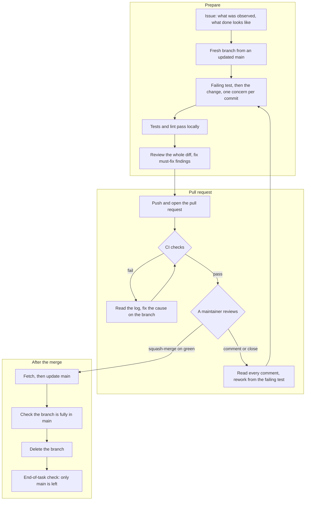

# Contributing

This document explains what this project is and the rules for contributing to it. Everyone who works in this repository follows it, whether a person or an AI coding agent. GitHub shows a link to this file to anyone who opens a pull request or creates an issue.[1]

**Contents**

1. [Hermes Agent, and where to ask about it](#1-hermes-agent-and-where-to-ask-about-it)
2. [What this project is for](#2-what-this-project-is-for)
3. [How the documents fit together](#3-how-the-documents-fit-together)
4. [Contribution workflow](#4-contribution-workflow)
5. [Coding standards](#5-coding-standards)
6. [Failure rules](#6-failure-rules)
7. [Logging rules](#7-logging-rules)
8. [Repository guards and CI](#8-repository-guards-and-ci)
9. [Contributing with an AI coding agent](#9-contributing-with-an-ai-coding-agent)

## 1. Hermes Agent, and where to ask about it

Hermes Agent is an open-source autonomous AI agent built by Nous Research. It runs on your own machine or a server, and you talk to it from a terminal, a desktop app or a messaging platform. It calls tools, keeps memory across sessions, and creates and improves its own skills from experience.[2] It is MIT-licensed and free to self-host.[3]

This project is a custom build on top of Hermes Agent. It does not replace the upstream documentation. For anything about Hermes itself, use the sources below. They are all published by Nous Research.

| Question | Where to look |
|---|---|
| What Hermes is, and how to install it | [Documentation home](https://hermes-agent.nousresearch.com/docs), [Installation](https://hermes-agent.nousresearch.com/docs/getting-started/installation), [Quickstart](https://hermes-agent.nousresearch.com/docs/getting-started/quickstart) |
| Which page to read for your level | [Learning path](https://hermes-agent.nousresearch.com/docs/getting-started/learning-path) |
| Common problems | [FAQ](https://hermes-agent.nousresearch.com/docs/reference/faq) |
| Configuration and security | [Configuration](https://hermes-agent.nousresearch.com/docs/user-guide/configuration), [Security](https://hermes-agent.nousresearch.com/docs/user-guide/security) |
| Tools and skills | [Tools](https://hermes-agent.nousresearch.com/docs/user-guide/features/tools), [Skills](https://hermes-agent.nousresearch.com/docs/user-guide/features/skills) |
| Built-in memory and external memory providers | [Memory](https://hermes-agent.nousresearch.com/docs/user-guide/features/memory), [Memory providers](https://hermes-agent.nousresearch.com/docs/user-guide/features/memory-providers) |
| Plugins and hooks | [Plugins](https://hermes-agent.nousresearch.com/docs/user-guide/features/plugins), [Hooks](https://hermes-agent.nousresearch.com/docs/user-guide/features/hooks) |
| Instruction files the agent loads (`AGENTS.md`, `SOUL.md`) | [Context files](https://hermes-agent.nousresearch.com/docs/user-guide/features/context-files) |
| How Hermes works inside | [Architecture](https://hermes-agent.nousresearch.com/docs/developer-guide/architecture), [Building a plugin](https://hermes-agent.nousresearch.com/docs/developer-guide/plugins), [Building a memory provider](https://hermes-agent.nousresearch.com/docs/developer-guide/memory-provider-plugin) |
| Updating Hermes | [Updating](https://hermes-agent.nousresearch.com/docs/getting-started/updating) |
| Source code, releases, and bugs in Hermes itself | [NousResearch/hermes-agent on GitHub](https://github.com/NousResearch/hermes-agent) |
| The documentation, for an AI agent | [llms.txt](https://hermes-agent.nousresearch.com/docs/llms.txt) (an index of every page), [llms-full.txt](https://hermes-agent.nousresearch.com/docs/llms-full.txt) (every page in one file) |
| Whether a site, download or account is really Hermes | [Official domains and sources](https://hermes-agent.nousresearch.com/docs/getting-started/official-domains) |

Three rules follow from this:

- **A question about stock Hermes behaviour goes to the Nous documentation**, not to an issue here.
- **A bug in Hermes itself is reported upstream**, in the Nous repository. Link it from an issue here if it blocks work.
- **Do not rely on third-party sites about Hermes.** Nous lists its official domains and accounts, and treats an installer, download, image or portal hosted anywhere else as untrusted.[3] Treat any other write-up about Hermes as unverified until the Nous documentation confirms it.

## 2. What this project is for

The goal is an agent whose answers can be relied on without re-checking them. It is pursued through four design goals; the limits of each are stated in ARCHITECTURE.md.

1. **Remember.** What was said, decided or learned is stored outside the model and searched on every message, so the agent answers from the record and not from what happens to be in its context.
2. **Verify before stating.** A factual statement is backed by something the agent looked up in that turn: a document, a file, a command result, or a stored fact with its date. When it cannot verify something, it says so.
3. **Be measurably right.** Accuracy is enforced by code and measured by an eval set. It is not requested in a prompt and assumed.
4. **Fail loudly and say how.** Every point of failure has a name. A failure, an empty result and a fallback can always be told apart, and none of them passes silently.

| Property | What delivers it | Where it is described |
|---|---|---|
| Remember | A shared memory store, searched on every message | ARCHITECTURE.md sections 2–4 |
| Verify before stating | Guards that withhold a reply until the required lookup has run | ARCHITECTURE.md section 5 |
| Be measurably right | Tests, the retrieval eval set, and the coding standards | ARCHITECTURE.md section 3.8; sections 4–5 here |
| Fail loudly | Failure codes, the `events` table and the daily failure report | ARCHITECTURE.md section 6; sections 6–7 here |

The same standard applies to contributions. A change that makes the agent sound more certain without making it more verifiable is rejected.

## 3. How the documents fit together

| Document | What it holds | Read it |
|---|---|---|
| `CONTRIBUTING.md` (this file) | The rules and the workflow | First, in full |
| [`ARCHITECTURE.md`](ARCHITECTURE.md) | How the build works: memory, retrieval, the store, guards, failure handling, logging | The sections for the part you are changing |
| [`OPERATIONS.md`](OPERATIONS.md) | Where the build runs, machine setup, scheduled jobs | Before changing anything about deployment or jobs |

Conventions used in all three:

- **Placeholders.** Values in angle brackets are filled in by the reader. Deployment values, such as `<project-ref>` or `<job-host>`, are set outside the repository and listed in OPERATIONS.md section 1. Workflow placeholders, such as `<branch>` or `<n>`, are defined where they are used. Real hostnames, project references, chat IDs and credentials never appear in the repository.
- **Hermes facts are versioned.** A statement about how Hermes behaves names the Hermes version it was checked against. Re-check it before relying on it with a newer version.

## 4. Contribution workflow

This repository uses GitHub, squash-merge as the only merge method, and `main` as the default branch. Maintainers merge.

Placeholders used below: `<owner>/<repo>`, `<branch>`, `<n>` (an issue or pull request number), `<type>` (a commit type such as `feat` or `fix`).

### 4.1 Rules

- **W1. Issue first.** Every pull request answers one issue. If none exists, create it before writing code: what was observed or asked for, and what done looks like. The issue is the whole scope. No change is too small for one.
- **W2. One branch per issue.** Name it `<type>/<short-description>`, cut it fresh from an up-to-date `main`, never reuse it for a second issue, and delete it once its pull request merges. `main` is the only long-lived branch.
- **W3. Test first, where a test can express it.** Write the test, watch it fail for the right reason, then write the minimum that passes. Write an error handler only when a test names the failure it handles. When a test cannot express the change, say so and report what was measured instead.
- **W4. One concern per commit**, with a conventional prefix: `feat:`, `fix:`, `refactor:`, `test:`, `chore:`, `docs:`, `ci:`.[4] A commit that needs "and" in its subject is two commits.
- **W5. Small pull requests.** One purpose each, with the tests for the change in the same pull request.
- **W6. Review before opening.** Review the branch's whole diff against `main`. Fix every must-fix finding on the branch and review again, until a round finds nothing or the remaining findings are recorded as open. Record in the pull request who reviewed, how many rounds, and the verdict.
- **W7. The pull request says what was actually done.** A conventional-commit title, `Closes #<n>`, the commits by concern, a Review section, a Validation section, and a "Found, not fixed" list.
- **W8. Maintainers merge, by squash, and only on green.** The maintainer reads `gh pr checks <n>` and merges only when every check passed. Contributors never merge a pull request, never enable auto-merge, and never push to `main`. Where branch protection is unavailable (section 8.1), a red check does not block a merge by itself, so this reading is the gate.
- **W9. Never rewrite or delete without a maintainer's yes.** That covers a hard reset, a force-push, and deleting a branch, local or remote.
- **W10. Maintainers change repository, account and database settings.** Propose the change with what it does, the risk and the rollback. Read the setting back after it is made.
- **W11. Verify before claiming.** Every statement about remote state (merged, CI green, a setting saved) comes from a fresh read, not from memory or from someone else's report.
- **W12. Scope is the issue.** Write no code for an edge case or a "what if" the issue does not name. Anything else you notice goes under "Found, not fixed", and each item ends with the issue that tracks it. Every item gets an issue. An item that needs no action is still filed, then closed as not planned.
- **W13. Never commit secrets**, in code, tests or commit messages.
- **W14. Leave the repository clean.** End every task with no uncommitted edits, no stashes and no untracked files.

### 4.2 The flow



### 4.3 Creating an issue

```bash
gh issue create --title "<what is wrong or wanted>" --body-file <file>
```

Issue body:

```markdown
**Observed or asked:** <the log line, the failing command, or the request>

**Done looks like:** <what can be checked when it is finished>

**On failure:** <crashes loudly, the default | keeps running, because <reason>; the failure is recorded as <failure code>>

**For a check or a guard:** <fails open | fails closed>, because <why>
```

Keep the issue number. The pull request needs it for `Closes #<n>`.

### 4.4 Branch and commits

Contributors with write access branch in this repository. Everyone else forks it and branches in the fork. In a fork, add this repository as a remote named `upstream` (`git remote add upstream https://github.com/<owner>/<repo>.git`) and read `upstream` wherever the commands in this section and in 4.6–4.7 say `origin` for `main`; push branches to `origin`, the fork.

```bash
git fetch --prune
git switch main
git merge --ff-only origin/main
git switch -c <type>/<short-description>
```

- Always fetch before the fast-forward. Without it git reports "Already up to date" and `main` stays behind.
- Stage by path. Never `git add -A` or `git add .`.
- The `.gitignore` is an allow-list (section 8), so a new file in a path it does not list is invisible to `git status`. `git add <path>` refuses such a path ("ignored by one of your .gitignore files"), and `git add -A` skips it silently. When a path is refused, add a line for it to `.gitignore` in the same pull request; never use `git add -f`.
- Before pushing, run `git status --short --ignored`. Every `!!` entry must be a cache or build directory, such as `.pytest_cache/` or `.ruff_cache/`. A file or directory of yours listed there is hidden by the allow-list and is not in your commits.
- When the tests come first, commit them on their own with "(red)" in the subject, then commit the change that makes them pass. The squash-merge keeps the failing commit off `main`.
- Run the full test suite and the linter before each commit that changes behaviour.

### 4.5 Opening the pull request

Write the body to a file outside the repository and pass it with `--body-file`. Drop a line of the template that does not apply, and say why.

```bash
git push -u origin <branch>
gh pr create --base main --head <branch> --title "<type>: <what changed>" --body-file <file>
```

```markdown
Closes #<n>

<Two or three sentences: what changed and why.>

## Commits
- `<hash>` <subject>. <What it touches.>

## Review
<Who or what reviewed, rounds, verdict. Findings fixed on the branch. Findings left open.>
- Error handling: <n> handlers added, each naming <types> and emitting <failure codes>.
- Failures and empty results: <how a caller tells them apart, or "no fallback added">.

## Validation
- Red first: `<test command>`: <n> failed, <n> passed, and why they failed.
- Green: `<test command>`: <n> passed. `<lint command>`: clean.
- Rendered or run: <what, where, by whom>.
- Not verified: <what was not checked>.

## Found, not fixed
- <Thing noticed outside the issue's scope.> #<n>
- <A thing that needs no action.> #<n> (closed, not planned)
```

Closing keywords such as `Closes` only work when the pull request targets the default branch.[5]

Before opening the pull request, file an issue for every found-not-fixed item, or add a comment to the issue it belongs with. When nothing was found, write "Nothing found".

```markdown
**Found in:** PR #<n>, under "Found, not fixed" (<date>).

**What:** <what was seen, and whether it was run or only traced>

**Why this issue exists:** <why it is worth recording>

**Severity:** <high | medium | low | none>

**Impact:** <who or what it affects>

**Does it need addressing?** <yes | later | a decision from <name> | no>
```

### 4.6 Reading the result

```bash
gh pr checks <n>
gh run view <run-id> --job <job-id> --log        # when a check fails: read the log, find the cause
gh pr view <n> --json state,mergedAt,mergeable,mergeStateStatus
```

Read all three places a reviewer can leave feedback:

```bash
gh api repos/<owner>/<repo>/issues/<n>/comments     # the conversation
gh api repos/<owner>/<repo>/pulls/<n>/reviews       # review verdicts
gh api repos/<owner>/<repo>/pulls/<n>/comments      # comments on lines
```

- **A pull request closed without merging, with a comment, is a rejection.** Rework it for what the comment asks, on a fresh branch from the current `main`, under the same issue with its scope updated.
- **When more is asked while the pull request is open, and it belongs to the same issue:** update the issue first, then add commits to the same branch, test first as before. Undo a pushed change with `git revert`, never with a reset or a force-push. Rewrite the pull request body after each push, and read CI on the new head commit.
- **A request that is a different concern** is a new issue and a new branch.
- **When the branch is out of date with `main`:** update it with a merge commit (`git fetch`, `git merge origin/main`, `git push`). Never rebase a pushed branch.
- **When a check fails:** fix the cause, not the check. If a scanner flags a line that is safe, trace why it is safe, mark that one line with the scanner's own marker and the reason, and say so in the pull request. This never applies to the lint rules in C2 (`BLE001`, `S110`, `E722`).
- **When `--log` returns nothing:** the job never started. Run `gh run view <run-id>` and read the annotations. If the cause is the environment and not the code, report it to a maintainer. Do not re-run the job or edit the workflow to get around it.

### 4.7 After the merge

1. Confirm the merge with `gh pr view <n> --json state,mergedAt,mergeCommit`. Then `git fetch --prune`, `git switch main`, `git merge --ff-only origin/main`.
2. Check the branch is fully in `main`. Print the file list first, `git diff --name-only origin/main...<branch>`, and make sure it is not empty. Then
   `git diff origin/main <branch> -- $(git diff --name-only origin/main...<branch>)` must print nothing.
   If it prints anything, stop and tell a maintainer.
3. Delete the branch, local and remote, with a maintainer's yes (W9). Give the tip hash so it can be restored. GitHub deletes the remote branch itself when automatic deletion is on (section 8.1).
4. Confirm CI passed on `main`: `gh run list --branch main --limit 1`. If it failed in the code, tell a maintainer at once and propose a revert pull request.
5. End-of-task check: `git status -sb`, `git branch -vv`, `git stash list`. Only `main` should be left. Then `git status --short --ignored`: every `!!` entry must be a cache or build directory (4.4). Anything else there was never committed; tell a maintainer.

### 4.8 What a squash-merge changes

- **A merged branch looks unmerged.** `git branch --merged main` does not list it. Use the files-identical check in 4.7.
- **A plain `git branch -d` may succeed or refuse**, depending on whether the remote branch still exists.[6] Do not use it to probe.
- **Never keep working on a squash-merged branch.**[7]
- **Keep pull request titles in the same style as commit subjects.** The squash commit on `main` takes its name from one or the other.[8]
- **Undo with a revert pull request**, never by rewriting `main`.[9]
- **If a force-push is ever approved**, use `--force-with-lease=<branch>:<expected-sha>`. The bare form is unsafe when anything fetches in the background, because the lease then checks against the freshly fetched tip.[10]

## 5. Coding standards

### 5.1 Rules

- **C1. Catch the error you expect, by name.** Before writing a handler, look up what the call raises, in the library's documentation or its source, and name that type. The `try` covers only the lines that can raise it. Imports, formatting and plain data handling stay outside.
- **C2. No catch-everything blocks.** Never write `except Exception`, `except BaseException` or a bare `except:`. Catch by name, or let it crash. For cleanup, use `try`/`finally`. Never silence the lint for this rule, by `noqa` comment, by configuration, or by excluding files; CI fails on each (section 8.2). The only exceptions are the two shared wrappers in the failure module (ARCHITECTURE.md sections 2 and 6.1): the boundary wrapper that every Hermes entry point goes through, and the job wrapper that every scheduled job goes through. Each catches everything, records the failure with its traceback, and then re-raises, blocks, returns a failure note or exits non-zero, as its entry point requires. They log with `logger.exception`, which ruff accepts without a `noqa`.[11] No other code catches everything.
- **C3. A failure never looks like an empty result.** Do not return `[]`, `None`, `0` or "skipped" for a failure when the same value also means "nothing found". Raise, or return a failure the caller has to check. A missing setting is a startup error, never a silent default.
- **C4. Let it crash.** Code fails loudly by default. Add handling that keeps code running only when the issue asks for it and gives the reason, and record the failure even then (section 6). "Must not crash" never means "must not show the failure".
- **C5. No bare "never raises", "fail open" or "best-effort".** In an issue, a brief, a docstring or a comment, follow each of those phrases with which failures it covers, the failure code that records them, and how the caller tells a failure from an empty result. A spec that says only "must never raise" invites a silent catch-everything handler.
- **C6. Prove every guard and every check.** It counts as working only after it has been seen to block its own failing case. A check must fail when its tool is missing or broken. A guard's enforcement step blocks or withholds; it never only warns. Reminders and `log` mode come before enforcement, not instead of it.
- **C7. Data this repository did not create is not ours to change.** In a database that holds tables, functions or data that this repository's migrations did not create, create new objects under new names, and never alter, rename or drop the existing ones. Objects this repository created change only through new forward migrations. Do not connect with a credential that can delete until a maintainer confirms an export exists.
- **C8. Retrieval changes come with numbers.** A change to chunking, embedding, fusion, reranking, recall delivery or any default in ARCHITECTURE.md section 3.6 reports the eval-set results before and after (ARCHITECTURE.md section 3.8).
- **C9. Code taken from elsewhere meets these rules before it merges.** Code copied or ported from another project, an earlier version of this build, or a generated draft has every handler narrowed to a named error with a failure code, or removed, in the same pull request.

### 5.2 Why error handling gets its own rules

A handler is a mute rule on an alert. Muting one alert you expect is fine, as long as it is still counted. Muting every alert from a server also mutes the outage.

Code that catches everything turns a real bug into a normal-looking result: an empty list, a "skipped" count, a default value. The program finishes, the tests pass, and the failure is found days later, if at all. For an agent whose purpose is to be trusted, a hidden failure is the worst kind. A crash is visible and gets fixed.

This is a known weakness of AI-written code in particular. In one large study of AI-authored commits, broad exception handling was the most common code smell found.[12] These rules exist so that it is never written here in the first place.

### 5.3 Examples

**Wrong:**

```python
def search(query):
    try:
        from store import client
        rows = client.search(query)
        return [format_row(r) for r in rows]
    except Exception:
        return []        # an outage, a typo and "no matches" all look the same
```

**Right: narrow and loud.**

```python
from store import client, StoreTimeout
from failures import RecallFailed, record_failure

def search(query):
    try:
        rows = client.search(query)                  # the only line that can raise it
    except StoreTimeout as e:
        record_failure("recall.timeout", reason=str(e))   # logged and written to events (section 6)
        return RecallFailed("recall.timeout")             # the caller must handle it
    return [format_row(r) for r in rows]             # [] here really means "nothing found"
```

| What happened | Result |
|---|---|
| Nothing matched | `[]` |
| The store timed out (expected) | `RecallFailed("recall.timeout")`, logged, recorded, and shown in the turn |
| A bug (unexpected) | A crash, recorded as `unhandled` with its traceback |

**Also right:**

- Cleanup with `try`/`finally`, which needs no `except` at all.
- A handler for one named error that is part of normal operation, such as `FileNotFoundError` when deleting a file that may already be gone, provided the outcome is still recorded where a caller or the daily report can see it.

### 5.4 What the lint catches, and what review catches

The lint fails a pull request on:

- `except Exception` or `except BaseException` (`BLE001`).[11]
- `try`-`except`-`pass` on a catch-everything block (`S110`). By default it flags only `Exception`, `BaseException` and a bare `except:`.[13][14]
- A bare `except:` (`E722`).
- Any suppression of `BLE001`, `S110` or `E722`: a `noqa` comment, a file-level `ruff: noqa` or `flake8: noqa`, ruff configuration that turns a rule off, globally or per file, or that excludes files or lives outside the root `pyproject.toml` (separate CI steps, section 8.2).

The reviewer checks what the lint cannot:

- A catch-everything block that re-raises, or that logs with the traceback. The lint does not flag either one.[11] Rule C2 forbids both, apart from its two shared wrappers.
- A failure returned as an empty value (C3).
- A `try` that covers more lines than it needs (C1).
- A handler or fallback with no failure code (F1).
- "Never raises", "fail open" or "best-effort" with nothing after it (C5).

## 6. Failure rules

Every point of failure is loud and distinguishable. The mechanism, including the catalog of failure codes, is in ARCHITECTURE.md section 6.

- **F1. Every failure has a named code from the catalog.** A handler or fallback emits one. There is no bare "error".
- **F2. Failed, empty and degraded are different results.** A failure is never returned as an empty result, and a fallback or a retry that succeeded is recorded as degraded, never as plain success.
- **F3. Every occurrence is logged and recorded.** Each one is logged at WARNING or above and written to the `events` table, through the one recording helper in the failure module. Errors that reach a Hermes entry point or a scheduled job are recorded by the boundary wrapper or the job wrapper (ARCHITECTURE.md sections 2 and 6.1), so code never relies on Hermes, which logs a repeated error only once.
- **F4. A failure that changed the answer is shown in the turn.** Every failure, shown or not, appears in the daily failure report.
- **F5. Recording a failure must not lose it.** If the `events` row cannot be written, the failure is logged locally at ERROR with `events.write_failed`.
- **F6. The catalog is enforced.** A test fails the build if a handler or fallback emits no code or a code not in the catalog. A failure that is not in the catalog is a bug, recorded with its traceback: inside Hermes by the boundary wrapper, and in a scheduled job by the job wrapper, which records it and then exits non-zero (ARCHITECTURE.md section 6.1).

## 7. Logging rules

Hermes owns logging for code that runs inside it: the log files, rotation and redaction (ARCHITECTURE.md section 7).

- **L1. One logger per module, through Hermes.** Use `logging.getLogger(__name__)`. Never add handlers or call `logging.basicConfig()`; a plugin that does bypasses Hermes's redaction. For free-text lines, pass values as `%`-style arguments, not f-strings, so formatting is deferred.[15]
- **L2. Use Hermes's log files and rotation.** Warnings and above also reach `errors.log`, so every failure is logged at WARNING or above (F3).
- **L3. Events go through one helper.** Decisions and failures are logged by the recording helper in the failure module, never by hand. It writes one line whose message is a single JSON object, and the matching `events` row, with the same fields: `code`, `source` (the machine), `project`, `session_id`, `turn`, `result` and `reason`, plus IDs, counts and scores. Extra fields that have an OpenTelemetry GenAI name (`gen_ai.operation.name`, `gen_ai.tool.name`, `error.type`) use it.[16]
- **L4. Redact before every write, not only before logging.** Every value written to the memory store or sent to a judge model passes through Hermes's redactor first. The build registers patterns for Supabase API keys (`sb_secret_`, `sb_publishable_`), which Hermes does not cover. A test proves it: a fake key sent through every write path never appears in a log line, a stored row or an outgoing request.[17]
- **L5. No content in logs.** Prompts, replies, judge input, and fact or chunk text never appear in a log line. Log IDs, counts, scores and hashes. Untrusted strings appear only as truncated values inside the JSON object.[16][17]

## 8. Repository guards and CI

A rule in this file does not block anything. These guards do. Each is proven with its failing case before it is relied on (rule C6).

| Guard | Rules | Where it lives | The failing case that proves it |
|---|---|---|---|
| Lint over the whole repository: ruff's default rules plus `BLE001` and `S110` | C1, C2 | `pyproject.toml`, the CI workflow | A pull request that adds `except Exception: pass` anywhere fails |
| Suppression ban for `BLE001`, `S110`, `E722` | C2 | The CI workflow | A pull request that adds `# noqa: BLE001`, a bare `# noqa`, a file-level `# ruff: noqa`, ruff configuration that turns one of these rules off, an `exclude`, or a ruff configuration file outside the root `pyproject.toml`, fails |
| Tests in CI | W3 | The CI workflow | A pull request with a failing test fails |
| Failure-catalog test | F1, F6 | The test suite | A handler that emits no code, or an unknown one, fails the build |
| Secret-leak test | L4, W13 | The test suite | A fake key that reaches a log line, a stored row or an outgoing request fails the build |
| Secret scan, as a pre-commit hook and as a CI job | W13 | A git hook, a workflow | A commit carrying a fake key is refused |
| Branch protection on `main` | W8, W9 | Repository settings; needs a public repository or a paid plan (8.1) | A direct push to `main` is rejected |
| An allow-list `.gitignore` | W13, W14 | The repository root | A credential or runtime file placed in the working tree does not show as untracked |
| Separate database roles for each machine and for maintenance | C7 | The database | With a machine's role, deleting a row or altering a table is refused |

There is no count ratchet: the repository starts with no catch-everything handlers, so the lint fails on the first one.

### 8.1 Repository settings

Branch protection and rulesets are available on public repositories, and on private repositories only with GitHub Pro, Team or Enterprise.[18] While this repository is private on GitHub Free, the last four rows below cannot be set. A red check then does not block a merge by itself, so W8 (merge only on green) and W9 rest on the maintainer and on how each agent is configured (section 9). The first three rows work on every plan.

| Setting | Why |
|---|---|
| Allow squash merging only | Every pull request lands on `main` as one commit.[7] |
| Default squash title: "Pull request title" | One naming rule for commits on `main`.[8] |
| Automatically delete head branches | Removes the remote branch on merge. For a pull request from a fork, the fork's own setting applies.[19] |
| Require a pull request before merging | Nothing lands without one.[18] |
| Do not allow bypassing the above settings | Administrators are exempt by default.[18] |
| Allow force pushes and allow deletions: off | Protects the history.[18] |
| Require status checks to pass. Add each CI check after it has run once and passed. | Nothing merges on a red check.[20] |

### 8.2 The CI workflow

Run the same commands a developer runs locally, on every pull request to `main` and on every push to it. Check the action versions before copying.

```yaml
name: CI
on:
  pull_request:
    branches: [main]
  push:
    branches: [main]
permissions:
  contents: read
jobs:
  tests:
    runs-on: ubuntu-latest
    steps:
      - uses: actions/checkout@v7
      - uses: actions/setup-python@v7
        with: { python-version: "3.12", cache: pip }
      - run: pip install -e ".[dev]"
      - run: ruff check .
      - name: no noqa that can silence the error-handling rules
        shell: bash
        run: |
          # Matches a bare noqa, a noqa naming one of these rules, and file-level ruff/flake8 noqa, in any case.
          set +e
          git grep -n -i -E '#[[:space:]]*noqa([[:space:]]*$|[[:space:]]*[^:[:space:]]|:[^#]*(BLE001|S110|E722))|(ruff|flake8):[[:space:]]*noqa' -- '*.py'
          rc=$?
          set -e
          # 1 = no match (pass); 0 = the matches printed above; anything else = git failed
          [ "$rc" -eq 1 ] || { echo "noqa ban: git grep exited $rc (0 = the matches above, other = git failed)"; exit 1; }
      - name: the error-handling rules are switched on
        shell: bash
        run: |
          # Lint a probe that breaks all three rules, with the repository's own ruff configuration.
          # Any configuration that turns a rule off (ignore, select, ruff.toml) makes its code disappear.
          set +e
          out=$(printf 'try:\n    pass\nexcept Exception:\n    pass\ntry:\n    pass\nexcept:\n    pass\n' \
            | ruff check --no-cache --output-format concise --stdin-filename ci_probe.py -)
          rc=$?
          set -e
          echo "$out"
          # 1 = findings reported (expected); 0 = the rules are off; anything else = ruff failed or is missing
          [ "$rc" -eq 1 ] || { echo "probe: ruff exited $rc, expected 1 (findings reported)"; exit 1; }
          for code in BLE001 S110 E722; do grep -q "$code" <<< "$out" || { echo "ruff no longer reports $code"; exit 1; }; done
      - name: ruff lints every tracked Python file
        shell: bash
        run: |
          # Catches anything that drops files from linting: include, exclude, .gitignore, ruff's default excludes.
          python - <<'PY'
          import pathlib, subprocess, sys
          root = pathlib.Path.cwd().resolve()
          run = lambda *cmd: subprocess.run(cmd, check=True, capture_output=True, text=True).stdout.splitlines()
          linted = {pathlib.Path(p).resolve().relative_to(root).as_posix() for p in run("ruff", "check", "--show-files", ".") if p.strip()}
          missing = sorted(set(run("git", "ls-files", "*.py")) - linted)
          sys.exit("tracked Python files that ruff does not lint:\n" + "\n".join(missing) if missing else 0)
          PY
      - name: ruff configuration lives in the root pyproject.toml and narrows nothing
        shell: bash
        run: |
          python - <<'PY'
          import os, subprocess, sys, tomllib
          if not os.path.exists("pyproject.toml"):
              sys.exit("no pyproject.toml at the repository root")
          rules = ("BLE001", "S110", "E722")
          def covers(code):   # a code or prefix that covers one of the rules, such as "E", "BLE" or "ALL"
              return code == "ALL" or any(r.startswith(code) for r in rules)
          tracked = subprocess.run(["git", "ls-files", "*ruff.toml", "*pyproject.toml"],
                                   check=True, capture_output=True, text=True).stdout.split()
          bad = [f"ruff configuration outside the root pyproject.toml: {f}" for f in tracked if f != "pyproject.toml"]
          ruff = tomllib.load(open("pyproject.toml", "rb")).get("tool", {}).get("ruff", {})
          for section in (ruff, ruff.get("lint", {})):
              for key in ("exclude", "extend-exclude"):
                  bad += [f"{key}: {pattern}" for pattern in section.get(key, [])]
              for key in ("per-file-ignores", "extend-per-file-ignores"):
                  bad += [f"{key}: {glob}: {c}" for glob, codes in section.get(key, {}).items() for c in codes if covers(c)]
          sys.exit("\n".join(bad) if bad else 0)
          PY
      - run: python -m pytest -q
```

Lint selection in `pyproject.toml`. Use `extend-select`, which adds to ruff's default rules and keeps `E722` on.[13][14]

```toml
[tool.ruff.lint]
extend-select = ["BLE001", "S110"]
```

- `ruff check .` covers every Python file in the repository, tests included. All ruff configuration lives in the root `pyproject.toml`: no `ruff.toml`, `.ruff.toml` or nested `pyproject.toml`, no `exclude` or `extend-exclude`, and no per-file ignores for these rules. With one configuration file, the probe step proves the rules are on for every file, and the coverage step proves every tracked Python file is linted, whatever would otherwise drop it (`include`, `.gitignore`, or ruff's default excludes such as `dist/`).
- Pin ruff to one version in the project's dev dependencies, so local runs and CI agree.
- The job name is what appears as the status check to require.
- Give any step that pipes a tool into a count or a test `shell: bash`, and never end it with `|| true`. Without `shell: bash` a failed command in the middle of a pipe does not stop the step, so a tool that did not start reads as a count of 0 and the check passes.[21] A check must tell "found nothing" from "the tool failed", as the `noqa` step above does. Prove each step with its failing case before relying on it (C6).
- Add a secret scan beside the tests.
- Add a dependency audit when there are dependencies: `pip-audit` with no arguments.[22]

### 8.3 When a guard or a permission blocks you

Do not look for another route to the same result.

1. Stop. Say what was blocked and that nothing changed.
2. Give a maintainer one command to run, with what it does, the risk, and the rollback.
3. When it is done, read the state back and report it.

## 9. Contributing with an AI coding agent

AI coding agents are welcome contributors, under the same rules as everyone else.

- **Keep every file Hermes loads as project context out of this repository.** When a Hermes session runs inside a repository, Hermes loads the first it finds of `.hermes.md` or `HERMES.md`, `AGENTS.override.md`, `AGENTS.md`, `CLAUDE.md`, and `.cursorrules` with `.cursor/rules/*.mdc`. It also picks up these files in subdirectories as the agent reads files there.[23] Any of them would turn development rules into the running agent's instructions. That is why this file is `CONTRIBUTING.md`. On the default macOS file system `Agents.md` and `AGENTS.md` are the same file, so do not use either spelling.
- **Give a coding agent its rules from outside the repository.** Use the agent's user-level instruction file: point it at this document, and copy in the rules from sections 4.1, 5.1, 6 and 7.
- **End every brief with the error-handling rule.** A brief that says code "must never raise" or must "fail open" invites a silent catch-everything handler (C5). Every brief given to a coding agent ends with this line, verbatim:

  > Error handling rule: catch the specific exception you expect, by name. Never return a value that also means "nothing found" or "skipped" for a failure; log every caught failure with its failure code, and let anything unexpected crash.

  The line restates C1–C4 and F1–F2. It is a request, not a guard: the lint and the tests in section 8 are what enforce the rules.
- **`SOUL.md` is never read from a repository.** Hermes reads it only from its home directory.[23] The agent's identity is installed there, not committed here.
- **Configure the agent so it cannot do what rules W8 and W9 forbid.** Deny it the commands that merge a pull request, push to `main`, force-push, reset hard, skip hooks, or delete a branch. A rule the agent can break is a request (ARCHITECTURE.md section 5.1). While branch protection is unavailable (section 8.1), this configuration is the only thing that enforces W8 and W9.
- **A person is accountable for every pull request**, whoever wrote the code.

## Sources

- [1] [Setting guidelines for repository contributors (GitHub Docs)](https://docs.github.com/en/communities/setting-up-your-project-for-healthy-contributions/setting-guidelines-for-repository-contributors)
- [2] [Hermes Agent documentation (Nous Research)](https://hermes-agent.nousresearch.com/docs)
- [3] [Official domains and sources (Hermes Agent documentation)](https://hermes-agent.nousresearch.com/docs/getting-started/official-domains)
- [4] [Conventional Commits 1.0.0](https://www.conventionalcommits.org/en/v1.0.0)
- [5] [Linking a pull request to an issue (GitHub Docs)](https://docs.github.com/en/issues/tracking-your-work-with-issues/using-issues/linking-a-pull-request-to-an-issue)
- [6] [git-branch documentation](https://git-scm.com/docs/git-branch)
- [7] [About merge methods on GitHub (GitHub Docs)](https://docs.github.com/en/repositories/configuring-branches-and-merges-in-your-repository/configuring-pull-request-merges/about-merge-methods-on-github)
- [8] [Configuring commit squashing for pull requests (GitHub Docs)](https://docs.github.com/en/repositories/configuring-branches-and-merges-in-your-repository/configuring-pull-request-merges/configuring-commit-squashing-for-pull-requests)
- [9] [Reverting a pull request (GitHub Docs)](https://docs.github.com/en/pull-requests/collaborating-with-pull-requests/incorporating-changes-from-a-pull-request/reverting-a-pull-request)
- [10] [git-push documentation](https://git-scm.com/docs/git-push)
- [11] [blind-except (BLE001) (Ruff documentation)](https://docs.astral.sh/ruff/rules/blind-except)
- [12] [Liu et al., Debt Behind the AI Boom, arXiv 2603.28592 version 3 (preprint)](https://arxiv.org/html/2603.28592v3)
- [13] [try-except-pass (S110) (Ruff documentation)](https://docs.astral.sh/ruff/rules/try-except-pass)
- [14] [Settings (Ruff documentation)](https://docs.astral.sh/ruff/settings)
- [15] [Logging HOWTO (Python 3.12 documentation)](https://docs.python.org/3.12/howto/logging.html)
- [16] [OpenTelemetry semantic conventions for generative AI](https://github.com/open-telemetry/semantic-conventions-genai)
- [17] [Logging Cheat Sheet (OWASP)](https://cheatsheetseries.owasp.org/cheatsheets/Logging_Cheat_Sheet.html)
- [18] [About protected branches (GitHub Docs)](https://docs.github.com/en/repositories/configuring-branches-and-merges-in-your-repository/managing-protected-branches/about-protected-branches)
- [19] [Managing the automatic deletion of branches (GitHub Docs)](https://docs.github.com/en/repositories/configuring-branches-and-merges-in-your-repository/configuring-pull-request-merges/managing-the-automatic-deletion-of-branches)
- [20] [About status checks (GitHub Docs)](https://docs.github.com/en/pull-requests/collaborating-with-pull-requests/collaborating-on-repositories-with-code-quality-features/about-status-checks)
- [21] [Workflow syntax for GitHub Actions (GitHub Docs)](https://docs.github.com/en/actions/reference/workflows-and-actions/workflow-syntax)
- [22] [pip-audit README](https://github.com/pypa/pip-audit/blob/main/README.md)
- [23] [Context files (Hermes Agent documentation)](https://hermes-agent.nousresearch.com/docs/user-guide/features/context-files)
