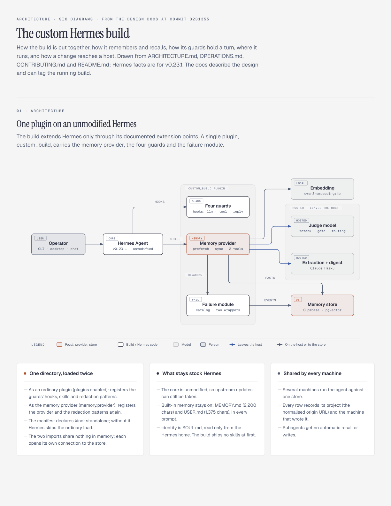
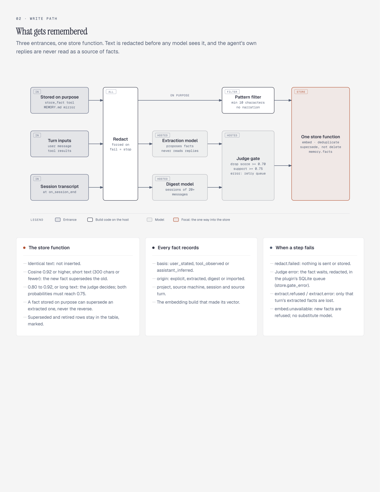
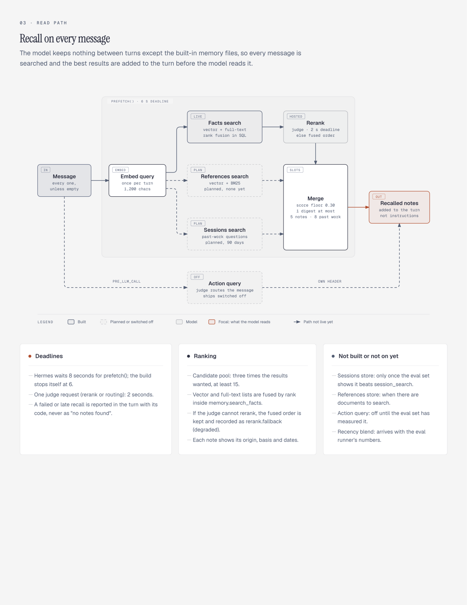
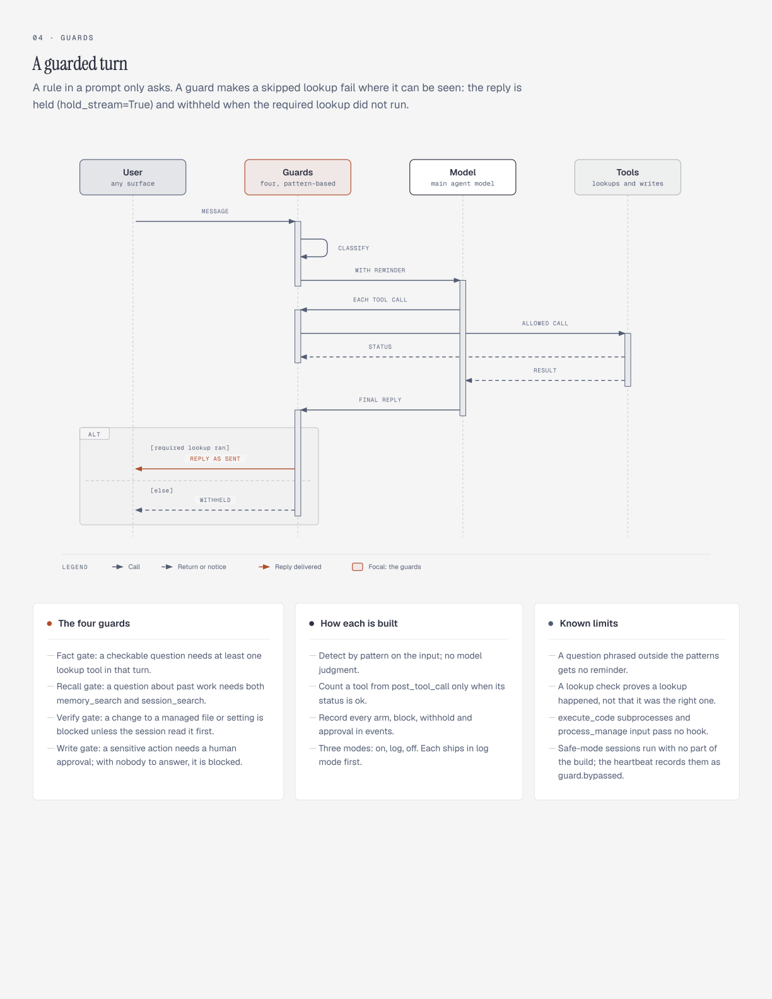
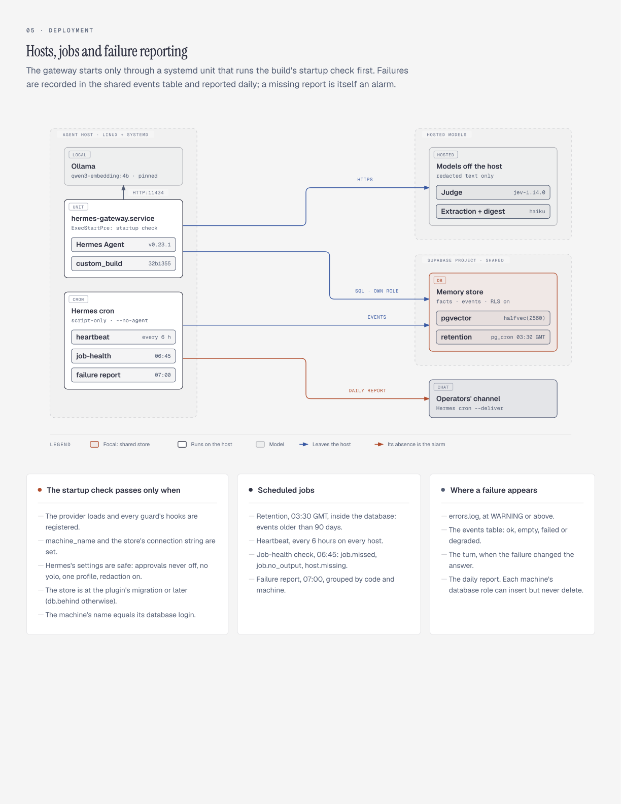
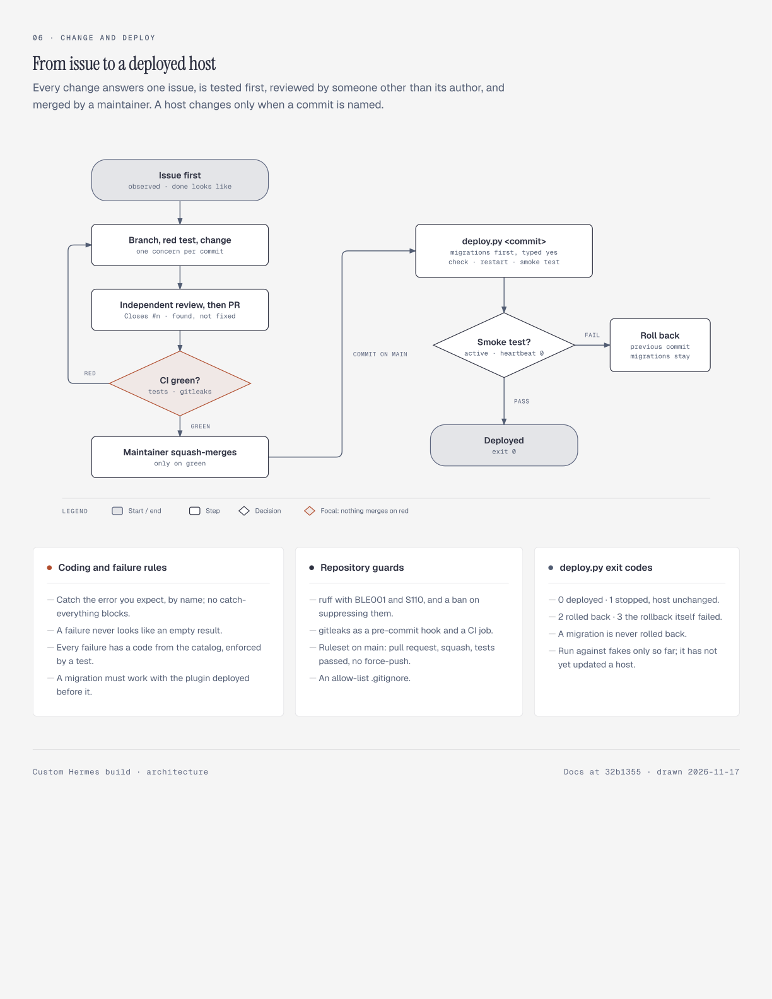

# Custom Hermes Agent

A custom build of [Hermes Agent](https://github.com/NousResearch/hermes-agent) that remembers across sessions, checks before it states, and reports every failure by name. It is one plugin, `custom_build`, on an unmodified Hermes core, so upstream updates can still be taken. Hermes facts here are for **Hermes v0.23.1**.

The goal is an agent whose answers can be relied on without re-checking them:

1. **Remember.** What was said, decided or learned is stored outside the model and searched on every message.
2. **Verify before stating.** A factual statement is backed by something the agent looked up in that turn.
3. **Be measurably right.** Accuracy is enforced by code and measured by an eval set, not requested in a prompt.
4. **Fail loudly and say how.** Every point of failure has a code. A failure, an empty result and a fallback can always be told apart.

> **Status.** The diagrams below were drawn from the design docs at commit `32b1355`. The docs describe the design and can lag the running build. Where they disagree with the code, the code is right: open an issue.

## How it fits together

The plugin carries the memory provider, four guards and the failure module. Several machines run the agent against one shared Supabase (Postgres + pgvector) store; every row records its project and the machine that wrote it.



*Embeddings run on a local Ollama (this machine's, or one on another machine), or on a hosted copy of the same model; a store holds one route's vectors only ([ARCHITECTURE.md](ARCHITECTURE.md) section 3.2). The diagram shows the local route.*

### What gets remembered

Three entrances (facts stored on purpose, turn inputs, the session transcript) feed one store function. Text is redacted before any model sees it, the agent's own replies are never read as a source of facts, and a judge gate drops facts not worth keeping. Superseded rows stay in the table, marked.



### Recall on every message

Every message is embedded and searched (vector and full-text, fused by rank in SQL), reranked by the judge model under a 2-second deadline, and the best results are added to the turn as recalled notes, labelled as notes and not instructions. A failed or late recall is reported in the turn with its code, never as "no notes found". Sessions and references search, and the action query, are planned or switched off until the eval set shows they help.



### Guards

A rule in a prompt only asks. A guard makes a skipped lookup fail where it can be seen: the reply is held and withheld when the required lookup did not run. The four guards are the fact gate, the recall gate, the verify gate and the write gate. Each ships in `log` mode first. Their known limits are on the diagram.



### Where it runs

The gateway starts only through a systemd unit whose `ExecStartPre` runs the build's startup check. Failures are written to the shared `events` table and reported daily at 07:00; a missing report is itself an alarm. Each machine's database role can insert events but never delete them.



### From issue to a deployed host

Every change answers one issue, is tested first, is reviewed by someone other than its author, and is squash-merged by a maintainer on green. A host changes only when a commit is named, through `scripts/deploy.py <commit>`. That script has been run against fakes only; it has not yet updated a host ([OPERATIONS.md](OPERATIONS.md) section 8).



## Repository layout

| Path | What it holds |
|---|---|
| `custom_build/` | The plugin: memory provider (`memory/`), guards (`guards/`), failure catalog, startup check, heartbeat, job-health and report jobs |
| `migrations/` | The store's schema, applied in file-name order after each pull request merges |
| `scripts/` | The operator's `deploy.py`, the read-only events viewer, and `reembed.py` |
| `evals/` | The retrieval eval runner and its pinned data reference |
| `tests/` | The test suite, including the allow-list `.gitignore` and the plugin-load tests |
| `docs/architecture/` | The diagrams on this page |

## Documents

| Document | Read it |
|---|---|
| [CONTRIBUTING.md](CONTRIBUTING.md) | First, in full: what the project is for, the workflow, coding, failure and logging rules, repository guards |
| [ARCHITECTURE.md](ARCHITECTURE.md) | The sections for the part you are changing: memory, retrieval, the store, guards, failure handling, logging |
| [OPERATIONS.md](OPERATIONS.md) | Before changing anything about deployment, machine setup or scheduled jobs |

## Development

Python 3.14 or later. CI installs Hermes v0.23.1 from its own lock file (`hermes-requirements.txt`), then the project, then runs the tests against a throwaway Postgres 17 with pgvector; see [`.github/workflows/ci.yml`](.github/workflows/ci.yml) for the exact steps.

```bash
pip install -e ".[dev]"
ruff check .
pytest
```

Nothing merges on red: a pull request needs passing tests and a clean `gitleaks` scan. Real hostnames, project references, chat IDs and credentials never appear in the repository; deployment values are placeholders listed in [OPERATIONS.md](OPERATIONS.md) section 1.
